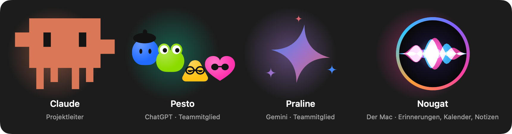
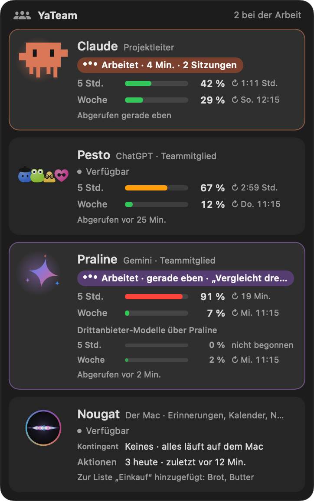

# YaTeam

[English](README.md) · [Français](README.fr.md) · **Deutsch** · [Español](README.es.md) · [Italiano](README.it.md) · [日本語](README.ja.md) · [中文](README.zh.md)



**Claude wird zum Projektleiter und arbeitet mit ChatGPT, Gemini und Ihrem Mac zusammen.**

YaTeam verbindet Claude mit Assistenten, die Sie vielleicht schon nutzen. Welche, wählen Sie bei der Installation; später können Sie welche hinzufügen oder entfernen:

| | Rolle | Läuft über |
|---|---|---|
| **Claude** | Projektleiter: entwirft, schreibt, entscheidet | die Claude-App oder Claude Code |
| **ChatGPT** | Teammitglied: Durchsichten, Zweitmeinungen, Prüfungen, Bilder | Codex CLI (OpenAI) |
| **Gemini** | Teammitglied: Websuche mit Quellen, Zusammenfassung großer Dokumente, Bilder | Antigravity CLI (Google) |
| **Der Mac** | Erinnerungen, Kalender, Notizen, Apps öffnen, Apple Intelligence | eine kleine App, die auf Ihrem Mac gebaut wird, ohne Kurzbefehl |

Sie sprechen wie gewohnt mit Claude. Wenn es hilft, delegiert Claude von sich aus („Ich bitte Praline, die Quellen zu prüfen“) oder auf Ihren Wunsch („Bitte Pesto, diese Datei gegenzulesen“, „Setz Brot auf meine Einkaufsliste“). ChatGPT und Gemini arbeiten **nur mit Lesezugriff**: Nur Claude ändert Ihre Dateien, und er prüft ihre Antworten, bevor er sie weitergibt. Der Mac handelt nur, wenn Sie darum bitten, und **sendet niemals** Nachrichten, E-Mails oder Einladungen.

Bei der Installation bekommt jedes Mitglied einen **lustigen Zufalls-Spitznamen** (Pesto, Praline, Nougat, Bagel …), den Sie behalten oder ändern können. YaTeam spricht **7 Sprachen**: Englisch, Französisch, Deutsch, Spanisch, Italienisch, Japanisch und Chinesisch.

## Was Sie bekommen

- **Einen Connector „equipe“** für die Claude-App (Chat, Cowork, Code-Tab) und für Claude Code im Terminal: ChatGPT oder Gemini eine Aufgabe geben, ein Bild erstellen und im Projektordner speichern lassen, eine Antwort später abholen (lange Aufgaben blockieren Claude nie), die Kontingente des Teams ansehen, und die Werkzeuge des Mac.
- **Das Mac-Mitglied** (optional): Ihre Erinnerungen-Listen lesen, ergänzen und abhaken, ein Ereignis zum Kalender hinzufügen (ohne jemals Ihren Kalender zu lesen), eine Notiz erstellen, eine App öffnen, Apple Intelligence eine kurze Frage stellen (auf dem Mac verarbeitet, nichts verlässt ihn). Kein Kurzbefehl zu erstellen.
- **Einen Claude-Code-Agenten pro Teammitglied**, um ihnen aus dem Terminal Aufgaben zu geben.
- **Eine Delegationsregel** in `~/.claude/CLAUDE.md`, damit Claude von sich aus an das Delegieren denkt.
- **Ein Panel** (optional), auf dem Schreibtisch oder schwebend: der verbrauchte Anteil jedes Kontingents über 5 Stunden und über die Woche, der Zeitpunkt des Zurücksetzens, wer gerade arbeitet und die Aktionen des Mac am heutigen Tag, mit einer kleinen animierten Figur pro Mitglied.



## Voraussetzungen

- **Ein Mac** mit macOS 14 (Sonoma) oder neuer.
- **Die Befehlszeilentools von Apple** (kostenlos, für Python und Swift). Fehlen sie, bietet das Installationsprogramm an, sie zu installieren; die App Xcode ist nicht nötig.
- **Claude**: die [Claude-Desktop-App](https://claude.ai/download) und/oder [Claude Code](https://claude.com/claude-code), mit Ihrem Claude-Abo.
- **Mindestens ein Mitglied**:
  - **ChatGPT**: das offizielle [Codex CLI von OpenAI](https://developers.openai.com/codex/cli), zum Beispiel `brew install --cask codex` mit [Homebrew](https://brew.sh) oder `npm install -g @openai/codex`. Starten Sie `codex` einmal im Terminal, melden Sie sich mit Ihrem ChatGPT-Konto an und beenden Sie es (`Ctrl + C`). Ein kostenloses Konto reicht für kleine Aufgaben; ein Abo bietet deutlich mehr Kontingent.
  - **Gemini**: das offizielle [Antigravity CLI von Google](https://antigravity.google) (Programm `agy`), zum Beispiel `brew install --cask antigravity-cli`. Starten Sie `agy` einmal, melden Sie sich mit Ihrem Google-Konto an und beenden Sie es (`Ctrl + C`). *Gemini CLI akzeptiert seit Juni 2026 keine Privatkonten mehr: Deshalb nutzt YaTeam Antigravity.*
  - **Der Mac**: nichts zu installieren. Für Fragen an Apple Intelligence: ein Mac mit Apple-Chip, macOS 26 oder neuer und aktivierter Apple Intelligence.
- **Um Claude im Panel zu verfolgen** (sein Kontingent und wann er arbeitet): Claude Code. Mit der Claude-App allein funktioniert alles, aber das Panel zeigt Claude nicht.

## Installation per Doppelklick

1. **Laden Sie** dieses Repository herunter: grüner Knopf „Code“ → „Download ZIP“. Doppelklicken Sie auf die .zip-Datei, um sie zu entpacken.
2. Doppelklicken Sie im entpackten Ordner auf **„Installer YaTeam“**.
3. **Beim ersten Mal blockiert macOS die Datei** (heruntergeladen, nicht mit einem Apple-Entwicklerkonto signiert): „„Installer YaTeam“ wurde nicht geöffnet“. Klicken Sie auf **Fertig**, öffnen Sie **Systemeinstellungen > Datenschutz & Sicherheit**, scrollen Sie zur Meldung über „Installer YaTeam“ und klicken Sie auf **Dennoch öffnen**, bestätigen Sie (Passwort oder Touch ID) und klicken Sie auf **Öffnen**. Das ist nur einmal nötig.
4. **Beantworten Sie die Fragen** in den Fenstern: die Sprache, welche KIs ins Team kommen (eine Frage pro KI; nicht installierte werden nicht angeboten), die Spitznamen, das Panel. Eine Zusammenfassung zeigt, was passieren wird; klicken Sie auf **Installieren**. Die Details laufen im Terminal-Fenster mit.
5. **Wenn Sie den Mac hinzugefügt haben**, fragt macOS für „YaTeam Mac“ nach Zugriff auf Ihre **Erinnerungen**, Ihren **Kalender** (nur Ereignisse hinzufügen) und dann nach der Steuerung von **Notizen**: Antworten Sie jedes Mal mit **Erlauben** bzw. **OK**.
6. Zum Schluss **beenden Sie die Claude-App vollständig (`Cmd + Q`) und öffnen sie erneut**, und starten eine neue Sitzung von Claude Code.

Jede geänderte Datei wird vorher in `~/.claude/equipe/sauvegardes/<Datum>/` gesichert (nur für Sie lesbar). Eine unlesbare Einstellungsdatei wird nie überschrieben: Das Installationsprogramm meldet sie und macht weiter. Ihre anderen Hooks, Connectors und Einstellungen bleiben unverändert.

**Wenn macOS die Datei nicht öffnet** (zum Beispiel weil beim Entpacken Rechte verloren gingen): Öffnen Sie die App **Terminal**, tippen Sie `cd` und ein Leerzeichen, ziehen Sie den entpackten Ordner ins Fenster, drücken Sie die Eingabetaste und starten Sie `./install.sh` (die Fragen werden dann im Terminal gestellt).

### Wie Claude das Team kennenlernt

- **Der Connector „equipe“**: Bei jedem Start stellt er Claude die gewählten Mitglieder, ihre Spitznamen und ihre Werkzeuge vor und sagt ihm, wann er delegieren soll. Deshalb öffnen Sie die Claude-App nach der Installation erneut.
- **Die Regel in `~/.claude/CLAUDE.md`**, die Claude Code in jeder Sitzung liest.
- **Die Agenten** von Claude Code (einer pro Teammitglied).

### Installation im Terminal

`./install.sh` stellt die Fragen im Terminal und fragt vor jedem Schritt nach (`j` ja, `n` nein, `a` alles annehmen). Optionen:

| Option | Wirkung |
|---|---|
| `--ai chatgpt,gemini,mac` | die zu aktivierenden Mitglieder (die anderen werden entfernt) |
| `--language de` | Sprache: `en` `fr` `de` `es` `it` `ja` `zh` |
| `--chatgpt-name Bagel` `--gemini-name Nori` `--mac-name Mango` | Spitznamen wählen |
| `--new-names` | neue Spitznamen auslosen |
| `--yes` | alles annehmen |
| `--no-widget` | das Panel nicht anbieten |
| `--windows` | Fragen in Fenstern (das macht der Doppelklick) |

Die Spitznamen stammen aus [`outils/noms.txt`](outils/noms.txt), einer in allen 7 Sprachen geprüften Liste (keine peinliche Bedeutung, keine bekannte Figur, kein bekanntes Produkt).

## Eine KI hinzufügen oder entfernen, Sprache oder Spitznamen ändern

- Im Panel: **Rechtsklick → Einstellungen… → Team ändern…**
- Oder doppelklicken Sie auf **„YaTeam ändern“** in `~/.claude/equipe/kit` (eine Kopie des Kits, die die Installation aufbewahrt: Den heruntergeladenen Ordner können Sie löschen).
- Oder starten Sie **„Installer YaTeam“** erneut aus dem heruntergeladenen Ordner.

Es erscheinen dieselben Fenster mit Ihrer aktuellen Auswahl. Beenden Sie danach die Claude-App und öffnen Sie sie erneut.

## Verwendung

Ein paar Beispiele für Claude (mit den Spitznamen Ihres Teams):

- „Bitte Praline, die drei besten aktuellen Quellen zu diesem Thema zu finden.“
- „Lass Pesto diese Datei gegenlesen, bevor du sie auslieferst.“
- „Gib Praline die Recherche, ohne zu warten, und schreib in der Zeit den Plan.“
- „Lass eine Illustration für die Startseite machen und speichere sie im Images-Ordner des Projekts.“
- „Was steht auf meiner Einkaufsliste? Setz Brot drauf und hak die Milch ab.“
- „Trag den Aufbau am Donnerstag, 8 bis 18 Uhr, in meinen Kalender ein.“
- „Erstelle eine Notiz mit dieser Zusammenfassung.“ · „Öffne den Rechner.“
- „Wie stehen die Kontingente des Teams?“

Nennen Sie im Chat-Tab der Claude-App den betreffenden Ordner auf dem Mac (zum Beispiel „in ~/Documents/MeinProjekt“), wenn es um Ihre Dateien oder ein zu speicherndes Bild geht. Um ohne das Team zu arbeiten, sagen Sie „ohne das Team“.

In Claude Code kann Claude Code beim ersten Start eines Teammitglieds durch einen Agenten um Erlaubnis bitten, dessen Skript auszuführen (`~/.claude/equipe/codex.sh` oder `antigravity.sh`).

## Das Mac-Mitglied

Es läuft über **„YaTeam Mac“**, eine kleine App ohne Fenster, die bei der Installation auf Ihrem Mac gebaut wird (Quellen in [`mac/`](mac/)): kein Kurzbefehl zu erstellen oder zu importieren. Sie hat eigene Berechtigungen, die Sie unter **Systemeinstellungen > Datenschutz & Sicherheit** finden:

- **Erinnerungen**: Ihre Listen lesen, Einträge hinzufügen (auf Wunsch mit Fälligkeit), abhaken oder als unerledigt markieren. Nur ein exakter Name wird abgehakt; ein nur ähnlicher Name wird vorgeschlagen, nie abgehakt. Nichts wird jemals gelöscht.
- **Kalender, nur Hinzufügen**: YaTeam fügt die gewünschten Ereignisse hinzu, ohne jemanden einzuladen, und **liest nie Ihren Kalender**.
- **Notizen**, über „Automation“: die gewünschten Notizen erstellen, ohne die anderen zu lesen.
- **Keine Bilder**: Image Playground lässt Apps nicht zeichnen; Bilder laufen über ChatGPT oder Gemini.
- **Apple Intelligence** (Mac mit Apple-Chip, macOS 26 oder neuer): kurze Fragen, auf dem Mac verarbeitet, ohne Web und ohne Dateien.

Claude erstellt Erinnerungen, Ereignisse oder Notizen, wenn Sie darum bitten; sonst schlägt er es vor und wartet auf Ihr Ja. Jede erfolgreiche Aktion wird in einem **lokalen Protokoll** festgehalten (`~/.claude/equipe/etat/journal-mac.txt`, nur für Sie lesbar), das Claude liest, um zu prüfen, ob eine Aktion geklappt hat. Der Text Ihrer Fragen an Apple Intelligence wird dort nicht gespeichert.

## Das Panel


Ein Panel (verschiebbar, auf allen Schreibtischen) und ein Symbol in der Menüleiste. Für jedes Mitglied: verbrauchter Anteil über 5 Std. und über die Woche, Zeitpunkt des Zurücksetzens, „Arbeitet“ mit Dauer und aktueller Aufgabe, oder „Wartet auf Sie“, wenn Claude auf eine Erlaubnis wartet. Für den Mac: seine Aktionen von heute und die letzte.

**Rechtsklick → Einstellungen…**:

- **Verbindungen**: „Neu verbinden…“ öffnet Terminal mit dem offiziellen Anmeldebefehl von Claude Code, Codex oder Antigravity, mit Hinweisen.
- **Team**: „Team ändern…“ (eine KI hinzufügen oder entfernen, Sprache, Spitznamen).
- **Der Mac**: Apple Intelligence, das Protokoll und die Berechtigungen.
- **Darstellung**: ausblendbare Karten, Panel **auf dem Schreibtisch** (hinter den Fenstern, Standard) oder **schwebend** darüber, Position, Öffnen bei der Anmeldung.
- **Kontingentabrufe**: wie oft die Kontingente von Claude und Gemini abgerufen werden.
- **Warnungen**: eine Mitteilung, wenn ein Kontingent 75, 80 oder 90 % überschreitet.

Woher die Zahlen kommen (kein Aufruf des Modells, also kein Kontingentverbrauch):

| | Kontingent | Aktivität |
|---|---|---|
| Claude | `claude -p /usage` (offizieller Befehl von Claude Code) | Hooks von Claude Code |
| ChatGPT | Zähler, die Codex selbst in `~/.codex/sessions` schreibt | Skript des Teammitglieds |
| Gemini | `agy -p /quota` (offizieller Befehl von Antigravity) | Skript des Teammitglieds |
| Der Mac | kein Kontingent | Connector (`~/.claude/equipe/etat/mac.json`) |

Wenn Antigravity eine erneute Google-Anmeldung verlangt, **öffnet YaTeam nie von selbst eine Anmeldeseite**: Ein falsches „open“ blockiert die Anfrage, die Abrufe von Gemini pausieren, und das Panel sagt es Ihnen. Melden Sie sich mit „Neu verbinden…“ erneut an und klicken Sie dann auf „Aktualisieren“.

Panel von Hand bauen: `./widget/outils/construire.sh --installer`. Es ist „ad hoc“ signiert (ohne Apple-Entwicklerkonto): Auf Ihrem Mac gebaut, öffnet es sich ohne Warnung. Zum Signieren mit Ihrem Developer-ID-Zertifikat: `YATEAM_IDENTITE="Developer ID Application: …" ./widget/outils/construire.sh --installer`.

## Datenschutz und Sicherheit

- YaTeam **startet nur die offiziellen Programme** (`claude`, `codex`, `agy`), die Sie selbst installiert und angemeldet haben, sowie seine kleine App „YaTeam Mac“. Es **liest, speichert und überträgt nie** Passwörter, Tokens oder Zugangsdaten.
- Kein Server, keine Statistiken, keine Telemetrie. Eine Aufgabe für ChatGPT oder Gemini geht an OpenAI oder Google; was Claude liest (Ihre Dateien, Ihre Erinnerungen), ist Teil Ihres Gesprächs mit Claude. Fragen an Apple Intelligence bleiben auf dem Mac.
- **Nur Lesezugriff**:
  - ChatGPT läuft in der schreibgeschützten Sandbox von Codex (`codex exec -s read-only`), vom System erzwungen;
  - Gemini läuft nicht interaktiv (`agy --sandbox -p`): Mit seinen Standardeinstellungen lehnt Antigravity von sich aus jede Aktion ab, die eine Erlaubnis braucht, und ein Auftrag erinnert es daran, nichts zu ändern. Das ist ein Schutz von Antigravity, keine Sperre des Systems: Haben Sie es so eingestellt, dass es alles automatisch genehmigt, greift er nicht mehr.
- **Der Mac**: Kein Werkzeug sendet Nachrichten, E-Mails oder Einladungen; der Kalender ist nur zum Hinzufügen; in Erinnerungen wird nichts gelöscht.
- Bilder können nur in Ihrem Benutzerordner gespeichert werden, außerhalb versteckter Ordner und der Library, und überschreiben nie eine vorhandene Datei.
- Geben Sie in einem Auftrag nie Passwörter, Schlüssel oder vertrauliche Daten weiter.

## Bei Problemen

- **macOS blockiert „Installer YaTeam“**: siehe Schritt 3 der Installation (Systemeinstellungen > Datenschutz & Sicherheit > Dennoch öffnen).
- **Claude kennt das Team in der Claude-App nicht**: Beenden Sie die App vollständig (`Cmd + Q`) und öffnen Sie sie erneut. Beim ersten Einsatz eines Team-Werkzeugs kann die App um Erlaubnis bitten.
- **„konnte nicht antworten (Kontingent aufgebraucht oder Anmeldung abgelaufen?)“**: Starten Sie `codex` oder `agy` im Terminal, um die Anmeldung zu prüfen, oder warten Sie auf das Zurücksetzen des Kontingents (im Panel sichtbar).
- **„Antigravity verlangt eine erneute Google-Anmeldung“**: Einstellungen des Panels → Neu verbinden… (oder `agy` im Terminal starten), dann „Aktualisieren“.
- **Der Mac liest Ihre Erinnerungen nicht**: Systemeinstellungen > Datenschutz & Sicherheit > Erinnerungen > „YaTeam Mac“ aktivieren (ebenso für Kalender; für Notizen: Automation > „YaTeam Mac“).
- **Das Kontingent von ChatGPT zeigt „Noch kein Wert“**: normal vor seiner ersten Aufgabe.
- Das Protokoll des Connectors liegt in `~/Library/Logs/Claude/mcp-server-equipe.log` (Finder: Gehe zu → Gehe zum Ordner).

## Grenzen

- **Nur macOS.** Kein Video: nur Standbilder.
- **Das kostenlose Kontingent von ChatGPT ist klein**: ein oder zwei kurze Aufgaben pro 5-Stunden-Fenster. Die Delegationsregel bittet Claude dann, Gemini zu nutzen.
- **Apple Intelligence** braucht einen Mac mit Apple-Chip, macOS 26 oder neuer und aktivierte Apple Intelligence. Der Mac zeichnet nicht: Bilder laufen über ChatGPT oder Gemini.
- „YaTeam Mac“ ist „ad hoc“ signiert: Ändert eine neue Version von YaTeam ihre Quellen, baut das Installationsprogramm sie neu, und macOS fragt erneut nach seinen Berechtigungen (Erinnerungen, Kalender, Notizen) (sonst ändert sich nichts).
- Eine Aufgabe wird nach 15 Minuten gestoppt. Eine nicht abgeholte Antwort wird nach einer Stunde vergessen, und laufende Aufgaben gehen verloren, wenn die Claude-App geschlossen wird.
- Die Kontingentabrufe stützen sich auf Ausgaben von `claude`, `codex` und `agy`, die keine öffentlichen Schnittstellen sind: Ein Update kann sie ändern. Das Panel zeigt dann „Wert nicht lesbar“ statt einer falschen Zahl.
- Die Namen der Werkzeuge sind in allen Sprachen gleich (`confier_a_…`, `mac_…`, `faire_une_image`, `attendre_reponse`, `quotas_equipe`): Ihre Beschreibungen sind übersetzt.

## Hinweis

YaTeam ist ein **inoffizielles Werkzeug**, unabhängig entwickelt, für den **persönlichen Gebrauch**. Es ist weder mit Anthropic, OpenAI, Google oder Apple verbunden noch von ihnen genehmigt. Claude und Claude Code sind Marken von Anthropic; ChatGPT und Codex von OpenAI; Gemini und Antigravity von Google; macOS, Apple Intelligence, Image Playground und Swift von Apple. Die Symbole des Panels sind selbst gezeichnete Bilder, die an den jeweiligen Assistenten erinnern; es sind nicht deren offizielle Logos.

Es startet auf Ihrem Mac nur die offiziellen Programme, die Sie installiert haben, mit Ihrem eigenen Konto. **Sie bleiben verantwortlich für die Einhaltung der Nutzungsbedingungen jedes Anbieters** (Abos, Nutzungsgrenzen, Regeln zur Automatisierung). Software „wie besehen“, ohne Gewähr (siehe [Lizenz](LICENSE)).

## Deinstallation

Doppelklicken Sie auf **„YaTeam deinstallieren“** in `~/.claude/equipe/kit` (eine einzige Bestätigung), oder starten Sie im Terminal:

```bash
./desinstaller.sh
```

Es entfernt genau das, was die Installation hinzugefügt hat (Hooks, Connector der Claude-App und von Claude Code, Agenten, Regel, Panel), mit einer Sicherung jeder geänderten Datei. Der Ordner `~/.claude/equipe` (mit seinen Sicherungen, der Kit-Kopie und der App YaTeam Mac) und das Panel kommen in den Papierkorb. Codex CLI, Antigravity CLI und Claude Code bleiben installiert: Sie gehören nicht zu YaTeam.

## Für Mitwirkende

```
Installer YaTeam.command   Installation per Doppelklick (install.sh --windows)
equipe/           Skripte, die nach ~/.claude/equipe kopiert werden: MCP-Connector (Python 3.9 ohne
                  Abhängigkeiten; Module noyau, garde, mac, images), Skripte der Teammitglieder, Hook
equipe/langues/   Übersetzungen (fr.json ist die Referenz; {name}-Werte setzt der Code ein)
mac/              „YaTeam Mac“ (Swift: EventKit, AppleScript, FoundationModels)
modeles/<code>/   Vorlagen der Claude-Code-Agenten und der Delegationsregel, pro Sprache
outils/           configurer.py (vorsichtige Änderungen an JSON und CLAUDE.md), noms.txt (Spitznamen)
widget/           SwiftUI-Panel (Swift-Paket, ohne Xcode) und seine Build-Skripte
tests/            Tests ohne Netz und ohne Kontingent: falsches codex, agy, claude, YaTeam Mac
                  und Fenster, temporärer Benutzerordner
```

Tests starten (sie berühren nie Ihren echten Benutzerordner, kompilieren nichts und öffnen kein Fenster):

```bash
./tests/lancer_tests.sh
```

**Eine Sprache hinzufügen**: Kopieren Sie `equipe/langues/en.json` und `modeles/en/` unter dem neuen Code, übersetzen Sie sie, fügen Sie den Code zu den Listen in `equipe/textes.py`, `install.sh` und `widget/Sources/Donnees/Textes.swift` hinzu sowie einen Ordner `<code>.lproj` in `mac/YaTeamMac/`, und starten Sie die Tests (sie prüfen, dass jeder Schlüssel und jeder `{Wert}` vorhanden ist).

Bilder für das README: `./widget/outils/instantanes.sh` (das Panel zeichnet seine Ansichten mit Demodaten in PNG-Dateien, in jeder Sprache, ohne Fenster).

**Eine Version veröffentlichen**: Erstellen Sie das Zip mit `ditto -c -k --keepParent yateam yateam.zip` (es behält die Ausführungsrechte) und testen Sie es vor der Veröffentlichung auf einem neuen macOS-Benutzerkonto: Download, Freigabe durch Gatekeeper, Installation per Doppelklick, Berechtigungen des Mac, dann Deinstallation.

## Lizenz

[MIT](LICENSE).
