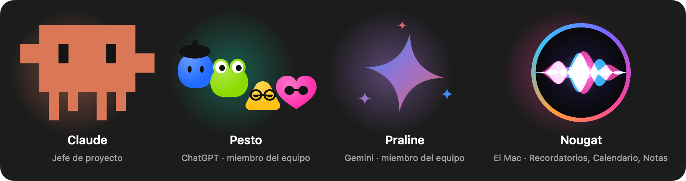
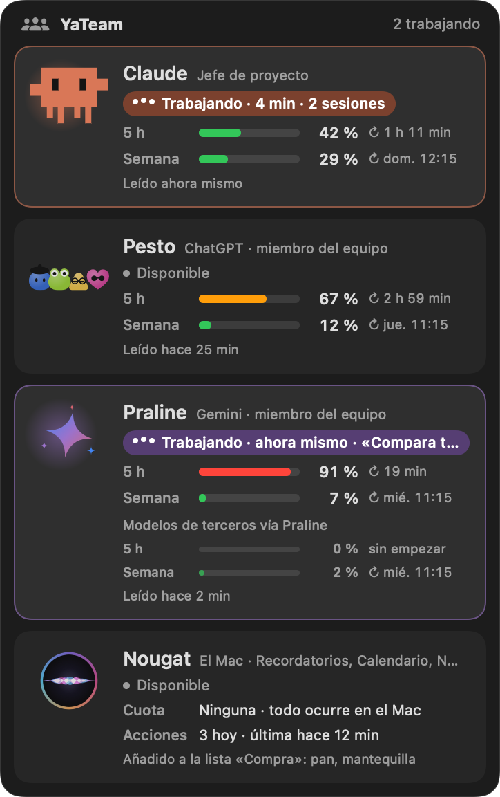

# YaTeam

[English](README.md) · [Français](README.fr.md) · [Deutsch](README.de.md) · **Español** · [Italiano](README.it.md) · [日本語](README.ja.md) · [中文](README.zh.md)



**Claude se convierte en jefe de proyecto y trabaja con ChatGPT, Gemini y tu Mac.**

YaTeam conecta a Claude con asistentes que quizá ya tienes. Eliges cuáles al instalarlo, y puedes añadir o quitar alguno más adelante:

| | Papel | Pasa por |
|---|---|---|
| **Claude** | jefe de proyecto: diseña, escribe, decide | la app Claude o Claude Code |
| **ChatGPT** | miembro del equipo: revisiones, segunda opinión, comprobaciones, imágenes | Codex CLI (OpenAI) |
| **Gemini** | miembro del equipo: búsqueda web con fuentes, síntesis de documentos grandes, imágenes | Antigravity CLI (Google) |
| **El Mac** | Recordatorios, Calendario, Notas, abrir apps, Apple Intelligence | una pequeña app construida en tu Mac, sin atajos que crear |

Hablas con Claude como siempre. Cuando es útil, delega por iniciativa propia («Le pido a Praline que compruebe las fuentes») o cuando se lo pides («Pide a Pesto que revise este archivo», «Añade pan a mi lista de la compra»). ChatGPT y Gemini trabajan **solo con acceso de lectura**: solo Claude modifica tus archivos, y comprueba sus respuestas antes de transmitírtelas. El Mac solo actúa cuando se lo pides y **nunca envía** mensajes, correos ni invitaciones.

Al instalarlo, cada miembro recibe un **apodo divertido al azar** (Pesto, Praline, Nougat, Bagel…), que puedes conservar o cambiar. YaTeam habla **7 idiomas**: inglés, francés, alemán, español, italiano, japonés y chino.

## Qué obtienes

- **Un conector «equipe»** para la app Claude (Chat, Cowork, pestaña Code) y para Claude Code en el Terminal: encargar una tarea a ChatGPT o a Gemini, hacer una imagen y guardarla en la carpeta de tu proyecto, recoger una respuesta más tarde (las tareas largas no bloquean a Claude), consultar las cuotas del equipo, y las herramientas del Mac.
- **El miembro Mac** (opcional): leer, completar y marcar tus listas de Recordatorios, añadir un evento al Calendario (sin leer nunca tu calendario), crear una nota, abrir una app, hacer una pregunta rápida a Apple Intelligence (procesada en el Mac, nada sale de él). Sin atajos que crear.
- **Un agente por miembro del equipo para Claude Code**, para encargarles tareas desde el Terminal.
- **Una regla de delegación** en `~/.claude/CLAUDE.md`, para que Claude piense en delegar sin que se lo pidan.
- **Un panel** (opcional), en el escritorio o flotante: la parte de cuota usada por cada uno en 5 horas y en la semana, la hora de reinicio, quién está trabajando y las acciones del día del Mac, con un pequeño personaje animado por miembro.



## Requisitos

- **Un Mac** con macOS 14 (Sonoma) o posterior.
- **Las herramientas de línea de comandos de Apple** (gratuitas, para Python y Swift). Si faltan, el instalador propone instalarlas; no hace falta la app Xcode.
- **Claude**: la [app Claude de escritorio](https://claude.ai/download) y/o [Claude Code](https://claude.com/claude-code), con tu suscripción de Claude.
- **Al menos un miembro**:
  - **ChatGPT**: el [Codex CLI oficial de OpenAI](https://developers.openai.com/codex/cli), por ejemplo `brew install --cask codex` con [Homebrew](https://brew.sh), o `npm install -g @openai/codex`. Ejecuta `codex` una vez en el Terminal, inicia sesión con tu cuenta de ChatGPT y sal (`Ctrl + C`). Una cuenta gratuita basta para tareas pequeñas; una suscripción da mucha más cuota.
  - **Gemini**: el [Antigravity CLI oficial de Google](https://antigravity.google) (programa `agy`), por ejemplo `brew install --cask antigravity-cli`. Ejecuta `agy` una vez, inicia sesión con tu cuenta de Google y sal (`Ctrl + C`). *Gemini CLI ya no acepta cuentas personales desde junio de 2026: por eso YaTeam pasa por Antigravity.*
  - **El Mac**: nada que instalar. Para las preguntas a Apple Intelligence: un Mac con chip de Apple, macOS 26 o posterior y Apple Intelligence activada.
- **Para seguir a Claude en el panel** (su cuota y cuándo trabaja): Claude Code. Con la app Claude sola todo funciona, pero el panel no muestra a Claude.

## Instalación con doble clic

1. **Descarga [YaTeam.zip](../../releases/latest/download/YaTeam.zip)** (última versión). Haz doble clic en el archivo .zip para descomprimirlo.
2. En la carpeta descomprimida, **haz doble clic en «Installer YaTeam»**.
3. **La primera vez, macOS lo bloquea** (archivo descargado, no firmado con una cuenta de desarrollador de Apple). Cierra el mensaje, abre **Ajustes del Sistema > Privacidad y seguridad**, baja hasta el mensaje sobre «Installer YaTeam» y haz clic en **Abrir igualmente**; confirma (contraseña o Touch ID) y haz clic en **Abrir**. Solo hay que hacerlo una vez.
4. **Responde a las preguntas** que aparecen en ventanas: el idioma, las IA que quieres añadir al equipo (una pregunta por IA; las que no están instaladas en tu Mac no se proponen), los apodos, el panel. Un resumen indica lo que se va a hacer; haz clic en **Instalar**. Los detalles aparecen en la ventana del Terminal.
5. **Si has añadido el Mac**, macOS pide para «YaTeam Mac» acceso a tus **Recordatorios**, a tu **Calendario** (solo añadir eventos) y después el control de **Notas**: responde **Permitir** u **OK** cada vez.
6. Al final, **cierra por completo la app Claude (`Cmd + Q`) y vuelve a abrirla**, y abre una sesión nueva de Claude Code.

Cada archivo modificado se guarda antes en `~/.claude/equipe/sauvegardes/<fecha>/` (solo tú puedes leerlo). Un archivo de ajustes ilegible nunca se sobrescribe: el instalador lo indica y sigue. Tus otros hooks, conectores y ajustes no se tocan.

**Si macOS no quiere abrir el archivo** (por ejemplo, porque se perdieron los permisos al descomprimir): abre la app **Terminal**, escribe `cd` seguido de un espacio, arrastra la carpeta descomprimida a la ventana, pulsa Intro y ejecuta `./install.sh` (las preguntas se hacen entonces en el Terminal).

### Cómo descubre Claude al equipo

- **El conector «equipe»**: en cada inicio presenta a Claude los miembros elegidos, sus apodos y sus herramientas, y le dice cuándo delegar. Por eso hay que volver a abrir la app Claude tras la instalación.
- **La regla de `~/.claude/CLAUDE.md`**, que Claude Code lee en cada sesión.
- **Los agentes** de Claude Code (uno por miembro del equipo).

### Instalación en el Terminal

`./install.sh` hace las preguntas en el Terminal y pide tu acuerdo antes de cada paso (`s` sí, `n` no, `todo` aceptarlo todo). Opciones:

| Opción | Efecto |
|---|---|
| `--ai chatgpt,gemini,mac` | los miembros que se activan (los demás se quitan) |
| `--language es` | idioma: `en` `fr` `de` `es` `it` `ja` `zh` |
| `--chatgpt-name Bagel` `--gemini-name Nori` `--mac-name Mango` | elegir los apodos |
| `--new-names` | sortear apodos nuevos |
| `--yes` | aceptarlo todo |
| `--no-widget` | no proponer el panel |
| `--windows` | las preguntas en ventanas (lo que hace el doble clic) |

Los apodos se sortean en [`outils/noms.txt`](outils/noms.txt), una lista revisada en los 7 idiomas (sin sentidos molestos, sin personajes ni productos conocidos).

## Añadir o quitar una IA, cambiar el idioma o los apodos

- En el panel: **clic derecho → Ajustes… → Modificar el equipo…**
- O haz doble clic en **«Modificar YaTeam»** en `~/.claude/equipe/kit` (una copia del kit que guarda la instalación: puedes borrar la carpeta descargada).
- O vuelve a abrir **«Installer YaTeam»** desde la carpeta descargada.

Aparecen las mismas ventanas, con tus elecciones actuales. Después, cierra y vuelve a abrir la app Claude.

## Uso

Algunos ejemplos para decirle a Claude (con los apodos de tu equipo):

- «Pide a Praline que encuentre las tres mejores fuentes recientes sobre este tema.»
- «Haz que Pesto revise este archivo antes de entregarlo.»
- «Encarga la búsqueda a Praline sin esperarla y, mientras tanto, escribe el plan.»
- «Haz que preparen una ilustración para la página de inicio y guárdala en la carpeta Images del proyecto.»
- «¿Qué hay en mi lista de la compra? Añade pan y marca la leche.»
- «Pon el montaje del jueves, de 8 a 18 h, en mi calendario.»
- «Crea una nota con este resumen.» · «Abre la Calculadora.»
- «¿Cómo van las cuotas del equipo?»

En la pestaña Chat de la app Claude, indica la carpeta del Mac (por ejemplo «en ~/Documents/MiProyecto») cuando la tarea trate de tus archivos o de una imagen que guardar. Para trabajar sin el equipo, di «sin el equipo».

En Claude Code, la primera vez que un agente lanza a un miembro del equipo, Claude Code puede pedirte permiso para ejecutar su script (`~/.claude/equipe/codex.sh` o `antigravity.sh`).

## El miembro Mac

Funciona mediante **«YaTeam Mac»**, una pequeña app sin ventana construida en tu Mac durante la instalación (código en [`mac/`](mac/)): sin atajos que crear ni importar. Tiene sus propios permisos, que encontrarás en **Ajustes del Sistema > Privacidad y seguridad**:

- **Recordatorios**: leer tus listas, añadir elementos (con fecha límite si quieres), marcarlos o desmarcarlos. Solo se marca un nombre exacto; un nombre parecido se propone, nunca se marca. Nunca se borra nada.
- **Calendarios, solo añadir**: YaTeam añade los eventos que pides, sin invitar a nadie, y **nunca lee tu calendario**.
- **Notas**, mediante «Automatización»: crear las notas que pidas, sin leer las demás.
- **Sin imágenes**: Image Playground no deja dibujar a las apps; las imágenes pasan por ChatGPT o Gemini.
- **Apple Intelligence** (Mac con chip de Apple, macOS 26 o posterior): preguntas rápidas procesadas en el Mac, sin web ni archivos.

Claude crea recordatorios, eventos o notas cuando se lo pides; si no, lo propone y espera tu sí. Cada acción completada se anota en un **registro local** (`~/.claude/equipe/etat/journal-mac.txt`, solo tú puedes leerlo), que Claude relee para comprobar que una acción se ha hecho. El texto de tus preguntas a Apple Intelligence no se copia ahí.

## El panel


Un panel (movible, en todos los escritorios) y un icono en la barra de menús. Para cada miembro: parte usada en 5 h y en la semana, hora de reinicio, «Trabajando» con la duración y la tarea en curso, o «Esperando tu respuesta» cuando Claude espera un permiso. Para el Mac: sus acciones del día y la última.

**Clic derecho → Ajustes…**:

- **Conexiones**: «Reconectar…» abre el Terminal con el comando oficial de inicio de sesión de Claude Code, Codex o Antigravity, con instrucciones.
- **Equipo**: «Modificar el equipo…» (añadir o quitar una IA, idioma, apodos).
- **El Mac**: Apple Intelligence, el registro y los permisos.
- **Visualización**: tarjetas que se pueden ocultar, panel **en el escritorio** (detrás de las ventanas, por defecto) o **flotante** encima de ellas, posición, apertura al iniciar sesión.
- **Lecturas de cuotas**: con qué frecuencia se leen las cuotas de Claude y Gemini.
- **Alertas**: una notificación cuando una cuota supera el 75, 80 o 90 %.

De dónde salen las cifras (sin llamar al modelo, así que sin consumir cuota):

| | Cuota | Actividad |
|---|---|---|
| Claude | `claude -p /usage` (comando oficial de Claude Code) | hooks de Claude Code |
| ChatGPT | contadores que Codex escribe en `~/.codex/sessions` | script del miembro del equipo |
| Gemini | `agy -p /quota` (comando oficial de Antigravity) | script del miembro del equipo |
| El Mac | sin cuota | conector (`~/.claude/equipe/etat/mac.json`) |

Si Antigravity pide volver a iniciar sesión en Google, YaTeam **nunca abre por su cuenta una página de inicio de sesión**: un «open» falso bloquea la solicitud, las lecturas de Gemini se ponen en pausa y el panel te lo dice. Vuelve a iniciar sesión con «Reconectar…» y haz clic en «Actualizar».

Construir el panel a mano: `./widget/outils/construire.sh --installer`. Está firmado «ad hoc» (sin cuenta de desarrollador de Apple): construido en tu Mac, se abre sin aviso. Para firmarlo con tu certificado Developer ID: `YATEAM_IDENTITE="Developer ID Application: …" ./widget/outils/construire.sh --installer`.

## Privacidad y seguridad

- YaTeam **solo ejecuta los programas oficiales** (`claude`, `codex`, `agy`) que tú has instalado y conectado, y su pequeña app «YaTeam Mac». **Nunca lee, guarda ni envía** contraseñas, tokens ni datos de acceso.
- Sin servidor, sin estadísticas, sin telemetría. Una tarea encargada a ChatGPT o a Gemini va a OpenAI o a Google; lo que Claude lee (tus archivos, tus Recordatorios) forma parte de tu conversación con Claude. Las preguntas a Apple Intelligence se quedan en el Mac.
- **Solo lectura**:
  - ChatGPT funciona en el entorno aislado de solo lectura de Codex (`codex exec -s read-only`), impuesto por el sistema;
  - Gemini funciona de forma no interactiva (`agy --sandbox -p`): con sus ajustes por defecto, Antigravity rechaza por sí mismo cualquier acción que requiera permiso, y una instrucción le recuerda no modificar nada. Es una protección de Antigravity, no un bloqueo del sistema: si lo has configurado para aprobarlo todo automáticamente, deja de aplicarse.
- **El Mac**: ninguna herramienta envía mensajes, correos ni invitaciones; el Calendario es solo para añadir; no se borra nada en Recordatorios.
- Las imágenes solo pueden guardarse en tu carpeta de usuario, fuera de las carpetas ocultas y de Library, y nunca sobrescriben un archivo existente.
- Nunca pongas contraseñas, claves ni datos confidenciales en un encargo.

## Si algo falla

- **macOS bloquea «Installer YaTeam»**: ver el paso 3 de la instalación (Ajustes del Sistema > Privacidad y seguridad > Abrir igualmente).
- **Claude no conoce al equipo en la app Claude**: cierra la app por completo (`Cmd + Q`) y vuelve a abrirla. La primera vez que Claude use una herramienta del equipo, la app puede pedirte permiso.
- **«no pudo responder (¿cuota agotada o sesión caducada?)»**: ejecuta `codex` o `agy` en el Terminal para comprobar la sesión, o espera al reinicio de la cuota (visible en el panel).
- **«Antigravity pide volver a iniciar sesión en Google»**: ajustes del panel → Reconectar… (o ejecuta `agy` en el Terminal) y luego «Actualizar».
- **El Mac no lee tus Recordatorios**: Ajustes del Sistema > Privacidad y seguridad > Recordatorios > activa «YaTeam Mac» (lo mismo para Calendarios; para Notas: Automatización > «YaTeam Mac»).
- **La cuota de ChatGPT indica «Sin lectura todavía»**: es normal antes de su primera tarea.
- El registro del conector está en `~/Library/Logs/Claude/mcp-server-equipe.log` (Finder: Ir → Ir a la carpeta).

## Límites

- **Solo macOS.** Sin vídeo: solo imágenes fijas.
- **La cuota gratuita de ChatGPT es pequeña**: una o dos tareas cortas por franja de 5 horas. La regla de delegación pide entonces a Claude que pase por Gemini.
- **Apple Intelligence** requiere un Mac con chip de Apple, macOS 26 o posterior y Apple Intelligence activada. El Mac no dibuja: las imágenes pasan por ChatGPT o Gemini.
- «YaTeam Mac» está firmada «ad hoc»: si una nueva versión de YaTeam cambia su código, el instalador la reconstruye y macOS vuelve a pedir sus permisos (Recordatorios, Calendario, Notas) (si no, nada cambia).
- Una tarea se detiene a los 15 minutos. Una respuesta no recogida se olvida al cabo de una hora, y las tareas en curso se pierden si se cierra la app Claude.
- Las lecturas de cuotas se basan en salidas de `claude`, `codex` y `agy` que no son interfaces públicas: una actualización puede cambiarlas. El panel muestra entonces «Lectura ilegible» en lugar de una cifra falsa.
- Los nombres de las herramientas son los mismos en todos los idiomas (`confier_a_…`, `mac_…`, `faire_une_image`, `attendre_reponse`, `quotas_equipe`): sus descripciones están traducidas.

## Aviso

YaTeam es una **herramienta no oficial**, desarrollada de forma independiente, para **uso personal**. No está afiliada a Anthropic, OpenAI, Google ni Apple, ni aprobada por ellos. Claude y Claude Code son marcas de Anthropic; ChatGPT y Codex, de OpenAI; Gemini y Antigravity, de Google; macOS, Apple Intelligence, Image Playground y Swift, de Apple. Los iconos del panel son dibujos propios que evocan a cada asistente; no son sus logotipos oficiales.

Solo ejecuta en tu Mac los programas oficiales que tú has instalado, con tu propia cuenta. **Sigues siendo responsable de respetar las condiciones de uso de cada proveedor** (suscripciones, límites de uso, normas sobre automatización). Software proporcionado «tal cual», sin garantía (ver la [licencia](LICENSE)).

## Desinstalación

Haz doble clic en **«Desinstalar YaTeam»** en `~/.claude/equipe/kit` (una sola confirmación), o ejecuta en el Terminal:

```bash
./desinstaller.sh
```

Quita exactamente lo que añadió la instalación (hooks, conector de la app Claude y de Claude Code, agentes, regla, panel), con una copia de seguridad de cada archivo modificado. La carpeta `~/.claude/equipe` (con sus copias de seguridad, la copia del kit y la app YaTeam Mac) y el panel van a la Papelera. Codex CLI, Antigravity CLI y Claude Code siguen instalados: no forman parte de YaTeam.

## Para colaboradores

```
Installer YaTeam.command   instalación con doble clic (install.sh --windows)
equipe/           scripts copiados en ~/.claude/equipe: conector MCP (Python 3.9 sin dependencias;
                  módulos noyau, garde, mac, images), scripts de los miembros, hook de Claude Code
equipe/langues/   traducciones (fr.json es la referencia; el código inserta los valores {nombre})
mac/              «YaTeam Mac» (Swift: EventKit, AppleScript, FoundationModels)
modeles/<código>/ plantillas de los agentes de Claude Code y de la regla de delegación, por idioma
outils/           configurer.py (cambios cuidadosos en JSON y CLAUDE.md), noms.txt (apodos)
widget/           panel SwiftUI (paquete Swift, sin Xcode) y sus scripts de construcción
tests/            pruebas sin red ni cuota: codex, agy, claude, YaTeam Mac y ventanas falsos,
                  carpeta de usuario temporal
```

Ejecutar las pruebas (nunca tocan tu carpeta de usuario real, no compilan nada ni abren ventanas):

```bash
./tests/lancer_tests.sh
```

**Añadir un idioma**: copia `equipe/langues/en.json` y `modeles/en/` con el nuevo código, tradúcelos, añade el código a las listas de `equipe/textes.py`, `install.sh` y `widget/Sources/Donnees/Textes.swift`, y una carpeta `<código>.lproj` en `mac/YaTeamMac/`, y ejecuta las pruebas (comprueban que cada clave y cada `{valor}` están presentes).

Capturas del README: `./widget/outils/instantanes.sh` (el panel dibuja sus vistas en archivos PNG con datos de demostración, en cada idioma, sin ventana).

**Publicar una versión**: crea el zip con `ditto -c -k --keepParent yateam yateam.zip` (conserva los permisos de ejecución) y pruébalo en una cuenta de macOS nueva antes de publicarlo: descarga, desbloqueo por Gatekeeper, instalación con doble clic, permisos del Mac y desinstalación.

## Licencia

[MIT](LICENSE).
