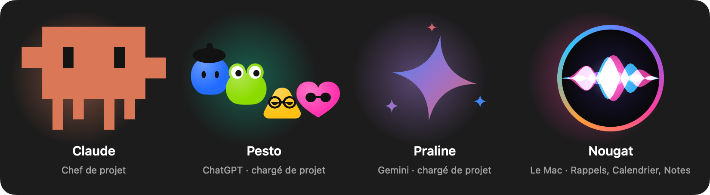
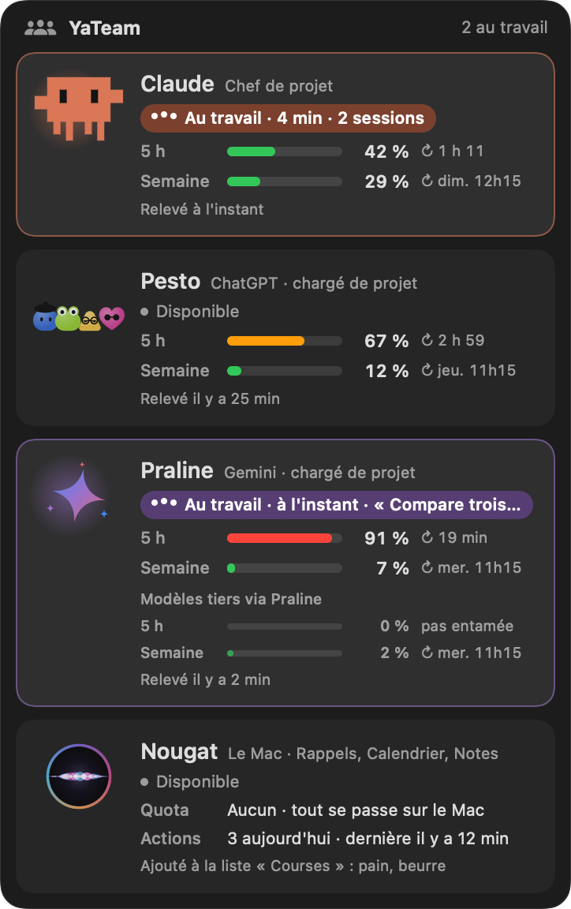

# YaTeam

[English](README.md) · **Français** · [Deutsch](README.de.md) · [Español](README.es.md) · [Italiano](README.it.md) · [日本語](README.ja.md) · [中文](README.zh.md)



**Claude devient chef de projet et travaille avec ChatGPT, Gemini et votre Mac.**

YaTeam relie à Claude les assistants que vous avez peut-être déjà. Vous choisissez lesquels à l'installation, et vous pouvez en ajouter ou en retirer ensuite :

| | Rôle | Passe par |
|---|---|---|
| **Claude** | chef de projet : conçoit, écrit, arbitre | l'app Claude ou Claude Code |
| **ChatGPT** | chargé de projet : relecture, deuxième avis, vérification, images | Codex CLI (OpenAI) |
| **Gemini** | chargé de projet : recherche web avec sources, synthèse de gros documents, images | Antigravity CLI (Google) |
| **Le Mac** | Rappels, Calendrier, Notes, ouvrir une app, Apple Intelligence | une petite app construite sur votre Mac, sans aucun raccourci à créer |

Vous parlez à Claude comme d'habitude. Quand c'est utile, il délègue de lui-même (« Je demande à Praline de vérifier les sources »), ou à votre demande (« Demande à Pesto de relire ce fichier », « Ajoute du pain à ma liste de courses »). ChatGPT et Gemini travaillent **en lecture seule** : seul Claude modifie vos fichiers, et il vérifie leurs réponses avant de vous les transmettre. Le Mac n'agit que quand vous le demandez, et **n'envoie jamais** de message, de mail ni d'invitation.

À l'installation, chaque membre reçoit un **surnom rigolo tiré au hasard** (Pesto, Praline, Nougat, Bagel…), que vous pouvez garder ou changer. YaTeam parle **7 langues** : anglais, français, allemand, espagnol, italien, japonais et chinois.

## Ce que vous obtenez

- **Un connecteur « equipe »** pour l'app Claude (Chat, Cowork, onglet Code) et pour Claude Code dans le Terminal : confier une tâche à ChatGPT ou à Gemini, faire une image et la ranger dans le dossier de votre projet, récupérer une réponse plus tard (les tâches longues ne bloquent pas Claude), consulter les quotas de l'équipe, et les outils du Mac.
- **Le membre Mac** (facultatif) : lire, compléter et cocher vos listes de Rappels, ajouter un événement au Calendrier (sans jamais lire votre agenda), créer une note, ouvrir une app, poser une question rapide à Apple Intelligence (traitée sur le Mac, rien n'en sort). Aucun raccourci à créer.
- **Un agent par chargé de projet pour Claude Code**, pour leur confier des tâches depuis le Terminal.
- **Une règle de délégation** dans `~/.claude/CLAUDE.md`, pour que Claude pense à déléguer sans qu'on le lui demande.
- **Un panneau** (facultatif), posé sur le bureau ou flottant : la part de quota utilisée par chacun sur 5 heures et sur la semaine, l'heure de remise à zéro, qui est au travail, et les actions du jour du Mac, avec un petit personnage animé par membre.



## Prérequis

- **Un Mac** sous macOS 14 (Sonoma) ou plus récent.
- **Les outils de ligne de commande d'Apple** (gratuits, pour Python et Swift). S'ils manquent, l'installateur propose de les installer ; l'app Xcode n'est pas nécessaire.
- **Claude** : l'[app Claude de bureau](https://claude.ai/download) et/ou [Claude Code](https://claude.com/claude-code), avec votre abonnement Claude.
- **Au moins un membre** :
  - **ChatGPT** : le [Codex CLI officiel d'OpenAI](https://developers.openai.com/codex/cli), par exemple `brew install --cask codex` avec [Homebrew](https://brew.sh), ou `npm install -g @openai/codex`. Lancez `codex` une fois dans le Terminal, connectez-vous avec votre compte ChatGPT, puis quittez (`Ctrl + C`). Un compte gratuit suffit pour de petites tâches ; un abonnement donne bien plus de quota.
  - **Gemini** : l'[Antigravity CLI officiel de Google](https://antigravity.google) (programme `agy`), par exemple `brew install --cask antigravity-cli`. Lancez `agy` une fois, connectez-vous avec votre compte Google, puis quittez (`Ctrl + C`). *Gemini CLI n'accepte plus les comptes particuliers depuis juin 2026 : c'est pourquoi YaTeam passe par Antigravity.*
  - **Le Mac** : rien à installer. Pour les questions à Apple Intelligence : un Mac à puce Apple sous macOS 26 ou plus récent, avec Apple Intelligence activée.
- **Pour suivre Claude dans le panneau** (son quota, et quand il travaille) : Claude Code. Avec l'app Claude seule, tout fonctionne, mais le panneau ne montre pas Claude.

## Installation par double-clic

1. **Téléchargez [YaTeam.zip](../../releases/latest/download/YaTeam.zip)** (dernière version). Double-cliquez sur le fichier .zip pour le décompresser.
2. Dans le dossier décompressé, **double-cliquez sur « Installer YaTeam »**.
3. **La première fois, macOS le bloque** (fichier téléchargé, non signé par un compte développeur Apple) : « Installer YaTeam » n'a pas été ouvert. Cliquez sur **Terminé**, ouvrez **Réglages Système > Confidentialité et sécurité**, descendez jusqu'au message sur « Installer YaTeam » et cliquez sur **Ouvrir quand même**, puis confirmez (mot de passe ou Touch ID) et cliquez sur **Ouvrir**. C'est à faire une seule fois.
4. **Répondez aux questions** qui s'affichent dans des fenêtres : la langue, les IA à ajouter à l'équipe (une question par IA ; celles qui ne sont pas installées sur votre Mac ne sont pas proposées), les surnoms, le panneau. Un résumé dit ce qui va être fait ; cliquez sur **Installer**. Le détail défile dans la fenêtre du Terminal.
5. **Si vous avez ajouté le Mac**, macOS demande pour « YaTeam Mac » l'accès à vos **Rappels**, à votre **Calendrier** (ajout d'événements seulement), puis le contrôle de **Notes** : répondez **Autoriser** ou **OK** à chaque fois.
6. À la fin, **quittez complètement l'app Claude (`Cmd + Q`) puis rouvrez-la**, et ouvrez une nouvelle session de Claude Code.

Chaque fichier modifié est d'abord sauvegardé dans `~/.claude/equipe/sauvegardes/<date>/` (lisible par vous seul). Un fichier de réglages illisible n'est jamais écrasé : l'installateur le signale et passe à la suite. Vos autres crochets, connecteurs et réglages restent intacts.

**Si macOS refuse d'ouvrir le fichier** (droits perdus à la décompression, par exemple) : ouvrez l'app **Terminal**, tapez `cd` suivi d'une espace, glissez le dossier décompressé dans la fenêtre, appuyez sur Entrée, puis lancez `./install.sh` (les questions se posent alors dans le Terminal).

### Comment Claude découvre l'équipe

- **Le connecteur « equipe »** : à chaque démarrage, il présente à Claude les membres choisis, leurs surnoms et leurs outils, et lui dit quand déléguer. C'est pourquoi il faut rouvrir l'app Claude après l'installation.
- **La règle de `~/.claude/CLAUDE.md`**, lue par Claude Code à chaque session.
- **Les agents** de Claude Code (un par chargé de projet).

### Installation dans le Terminal

`./install.sh` pose les questions dans le Terminal et demande votre accord avant chaque étape (`o` oui, `n` non, `t` tout accepter). Options :

| Option | Effet |
|---|---|
| `--ia chatgpt,gemini,mac` | les membres à activer (les autres sont retirés) |
| `--langue de` | langue : `en` `fr` `de` `es` `it` `ja` `zh` |
| `--nom-chatgpt Bagel` `--nom-gemini Nori` `--nom-mac Mango` | choisir les surnoms |
| `--nouveaux-noms` | tirer de nouveaux surnoms au hasard |
| `--oui` | tout accepter |
| `--sans-widget` | ne pas proposer le panneau |
| `--fenetres` | les questions dans des fenêtres (c'est ce que fait le double-clic) |

Les surnoms sont tirés dans [`outils/noms.txt`](outils/noms.txt), une liste vérifiée dans les 7 langues (aucun sens gênant, aucun personnage ni produit connu).

## Ajouter ou retirer une IA, changer la langue ou les surnoms

- Dans le panneau : **clic droit → Réglages… → Modifier l'équipe…**
- Ou double-cliquez sur **« Modifier YaTeam »** dans `~/.claude/equipe/kit` (une copie du kit gardée par l'installation : vous pouvez effacer le dossier téléchargé).
- Ou relancez **« Installer YaTeam »** depuis le dossier téléchargé.

Les mêmes fenêtres s'affichent, avec vos choix actuels. Ensuite, quittez puis rouvrez l'app Claude.

## Utilisation

Quelques exemples à dire à Claude (avec les surnoms de votre équipe) :

- « Demande à Praline de trouver les trois meilleures sources récentes sur ce sujet. »
- « Fais relire ce fichier par Pesto avant de le livrer. »
- « Confie la recherche à Praline sans l'attendre, et pendant ce temps écris le plan. »
- « Fais faire une illustration pour la page d'accueil et range-la dans le dossier Images du projet. »
- « Qu'est-ce qu'il y a sur ma liste de courses ? Ajoute du pain et coche le lait. »
- « Mets le montage de jeudi, 8 h – 18 h, dans mon calendrier. »
- « Crée une note avec ce résumé. » · « Ouvre la Calculatrice. »
- « Où en sont les quotas de l'équipe ? »

Dans l'onglet Chat de l'app Claude, précisez le dossier du Mac concerné (par exemple « dans ~/Documents/MonProjet ») quand la tâche porte sur vos fichiers ou sur une image à enregistrer. Pour travailler sans l'équipe, dites « sans l'équipe ».

Dans Claude Code, la première fois qu'un agent lance un chargé de projet, Claude Code peut vous demander l'autorisation d'exécuter son script (`~/.claude/equipe/codex.sh` ou `antigravity.sh`).

## Le membre Mac

Il passe par **« YaTeam Mac »**, une petite app sans fenêtre construite sur votre Mac à l'installation (sources dans [`mac/`](mac/)) : aucun raccourci à créer ni à importer. Elle a ses propres autorisations, que vous retrouvez dans **Réglages Système > Confidentialité et sécurité** :

- **Rappels** : lire vos listes, ajouter des éléments (avec une échéance si vous voulez), cocher ou décocher. Seul un nom exact est coché ; un nom seulement proche est proposé, jamais coché. Rien n'est jamais supprimé.
- **Calendriers, en ajout seulement** : YaTeam ajoute les événements que vous demandez, sans inviter personne, et **ne lit jamais votre agenda**.
- **Notes**, par « Automatisation » : créer les notes que vous demandez, sans lire les autres.
- **Pas d'images** : Image Playground ne laisse pas les apps dessiner ; les images passent par ChatGPT ou Gemini.
- **Apple Intelligence** (Mac à puce Apple, macOS 26 ou plus récent) : questions rapides traitées sur le Mac, sans web ni fichiers.

Claude crée des rappels, des événements ou des notes quand vous le lui demandez ; sinon il le propose et attend votre accord. Chaque action réussie est notée dans un **journal local** (`~/.claude/equipe/etat/journal-mac.txt`, lisible par vous seul), que Claude relit pour vérifier qu'une action a abouti. Le texte de vos questions à Apple Intelligence n'y est pas recopié.

## Le panneau


Un panneau (déplaçable, sur tous les bureaux) et une icône dans la barre des menus. Pour chaque membre : part utilisée sur 5 h et sur la semaine, heure de remise à zéro, « Au travail » avec la durée et la tâche en cours, ou « Attend votre réponse » quand Claude attend une autorisation. Pour le Mac : ses actions du jour et la dernière.

**Clic droit → Réglages…** :

- **Connexions** : « Reconnecter… » ouvre le Terminal sur la commande de connexion officielle de Claude Code, Codex ou Antigravity, avec les explications.
- **Équipe** : « Modifier l'équipe… » (ajouter ou retirer une IA, langue, surnoms).
- **Le Mac** : Apple Intelligence, le journal et les autorisations.
- **Affichage** : cartes masquables, panneau **posé sur le bureau** (derrière les fenêtres, par défaut) ou **flottant** au-dessus d'elles, position, ouverture à l'ouverture de session.
- **Relevés** : fréquence des relevés de Claude et de Gemini.
- **Alertes** : une notification quand un quota dépasse 75, 80 ou 90 %.

D'où viennent les chiffres (aucun appel au modèle, donc aucun quota consommé) :

| | Quota | Activité |
|---|---|---|
| Claude | `claude -p /usage` (commande officielle de Claude Code) | crochets de Claude Code |
| ChatGPT | compteurs que Codex écrit lui-même dans `~/.codex/sessions` | script du chargé de projet |
| Gemini | `agy -p /quota` (commande officielle d'Antigravity) | script du chargé de projet |
| Le Mac | pas de quota | connecteur (`~/.claude/equipe/etat/mac.json`) |

Si Antigravity demande de se reconnecter à Google, YaTeam **n'ouvre jamais de page de connexion de lui-même** : un faux « open » bloque la demande, les relevés de Gemini se mettent en pause, et le panneau vous le dit. Reconnectez-vous avec « Reconnecter… », puis cliquez sur « Actualiser ».

Construire le panneau à la main : `./widget/outils/construire.sh --installer`. Il est signé « ad hoc » (sans compte développeur Apple) : construit sur votre Mac, il s'ouvre sans alerte. Pour le signer avec votre certificat Developer ID : `YATEAM_IDENTITE="Developer ID Application: …" ./widget/outils/construire.sh --installer`.

## Confidentialité et sécurité

- YaTeam **ne lance que les programmes officiels** (`claude`, `codex`, `agy`) que vous avez installés et connectés vous-même, et sa petite app « YaTeam Mac ». Il **ne lit, ne stocke ni ne transmet jamais** de mot de passe, de jeton ou d'identifiant.
- Pas de serveur, pas de statistiques, pas de télémétrie. Une consigne confiée à ChatGPT ou à Gemini part chez OpenAI ou Google ; ce que Claude lit (vos fichiers, vos Rappels) fait partie de votre conversation avec Claude. Les questions à Apple Intelligence restent sur le Mac.
- **Lecture seule** :
  - ChatGPT tourne dans le bac à sable de Codex en lecture seule (`codex exec -s read-only`), imposé par le système ;
  - Gemini tourne en mode non interactif (`agy --sandbox -p`) : avec ses réglages par défaut, Antigravity refuse de lui-même toute action qui demande une autorisation, et une consigne lui rappelle de ne rien modifier. C'est une protection d'Antigravity, pas un verrou du système : si vous l'avez réglé pour tout approuver automatiquement, elle ne s'applique plus.
- **Le Mac** : aucun outil n'envoie de message, de mail ni d'invitation ; le Calendrier est en ajout seulement ; rien n'est supprimé dans Rappels.
- Les images ne peuvent être rangées que dans votre dossier personnel, hors dossiers cachés et Bibliothèque, et n'écrasent jamais un fichier existant.
- Ne confiez jamais de mot de passe, de clé ou de donnée confidentielle dans une consigne.

## En cas de problème

- **macOS bloque « Installer YaTeam »** : voir l'étape 3 de l'installation (Réglages Système > Confidentialité et sécurité > Ouvrir quand même).
- **Claude ne connaît pas l'équipe dans l'app Claude** : quittez complètement l'app (`Cmd + Q`) puis rouvrez-la. La première fois que Claude utilise un outil de l'équipe, l'app peut demander de l'autoriser.
- **« n'a pas pu répondre (quota épuisé ou connexion expirée ?) »** : lancez `codex` ou `agy` dans le Terminal pour vérifier la connexion, ou attendez la remise à zéro du quota (visible dans le panneau).
- **« Antigravity demande une reconnexion Google »** : Réglages du panneau → Reconnecter… (ou lancez `agy` dans le Terminal), puis « Actualiser ».
- **Le Mac ne lit pas vos Rappels** : Réglages Système > Confidentialité et sécurité > Rappels > activez « YaTeam Mac » (même chose pour Calendriers ; pour Notes : Automatisation > « YaTeam Mac »).
- **Le quota de ChatGPT indique « Aucun relevé »** : normal avant sa première tâche.
- Le journal du connecteur est dans `~/Library/Logs/Claude/mcp-server-equipe.log` (Finder : Aller → Aller au dossier).

## Limites

- **macOS uniquement.** Pas de vidéo : images fixes seulement.
- **Le quota gratuit de ChatGPT est faible** : une ou deux tâches courtes par tranche de 5 heures. La règle de délégation demande alors à Claude de passer par Gemini.
- **Apple Intelligence** demande un Mac à puce Apple sous macOS 26 ou plus récent, avec Apple Intelligence activée. Le Mac ne dessine pas : les images passent par ChatGPT ou Gemini.
- « YaTeam Mac » est signée « ad hoc » : si une nouvelle version de YaTeam change ses sources, l'installateur la reconstruit et macOS redemande ses autorisations (Rappels, Calendrier, Notes) (sinon, rien ne change).
- Une tâche est arrêtée au bout de 15 minutes. Une réponse non récupérée est oubliée au bout d'une heure, et les tâches en cours sont perdues si l'app Claude se ferme.
- Les relevés de quota s'appuient sur des sorties de `claude`, `codex` et `agy` qui ne sont pas des interfaces publiques : une mise à jour peut les changer. Le panneau affiche alors « Relevé illisible » au lieu d'un chiffre faux.
- Les noms des outils restent les mêmes dans toutes les langues (`confier_a_…`, `mac_…`, `faire_une_image`, `attendre_reponse`, `quotas_equipe`) : leurs descriptions sont traduites.

## Avertissement

YaTeam est un **outil non officiel**, développé indépendamment, pour un **usage personnel**. Il n'est ni affilié à Anthropic, OpenAI, Google ou Apple, ni approuvé par eux. Claude et Claude Code sont des marques d'Anthropic ; ChatGPT et Codex, d'OpenAI ; Gemini et Antigravity, de Google ; macOS, Apple Intelligence, Image Playground et Swift, d'Apple. Les icônes du panneau sont des dessins maison qui évoquent chaque assistant ; ce ne sont pas leurs logos officiels.

Il ne fait que lancer sur votre Mac les programmes officiels installés par vous, avec votre propre compte. **Vous restez responsable du respect des conditions d'utilisation de chaque éditeur** (abonnements, limites d'usage, règles sur l'automatisation). Logiciel fourni « tel quel », sans garantie (voir la [licence](LICENSE)).

## Désinstallation

Double-cliquez sur **« Désinstaller YaTeam »** dans `~/.claude/equipe/kit` (une seule confirmation), ou lancez dans le Terminal :

```bash
./desinstaller.sh
```

Il retire exactement ce que l'installation a ajouté (crochets, connecteur de l'app Claude et de Claude Code, agents, règle, panneau), avec une sauvegarde de chaque fichier modifié. Le dossier `~/.claude/equipe` (avec ses sauvegardes, la copie du kit et l'app YaTeam Mac) et le panneau vont à la Corbeille. Codex CLI, Antigravity CLI et Claude Code restent installés : ils ne font pas partie de YaTeam.

## Pour les contributeurs

```
Installer YaTeam.command   installation par double-clic (install.sh --fenetres)
equipe/           scripts copiés dans ~/.claude/equipe : connecteur MCP (Python 3.9 sans dépendance,
                  modules noyau, garde, mac, images), scripts des chargés de projet, crochet de Claude Code
equipe/langues/   traductions (fr.json fait référence ; les valeurs {nom} sont insérées par le code)
mac/              « YaTeam Mac » (Swift : EventKit, AppleScript, FoundationModels)
modeles/<langue>/ modèles des agents de Claude Code et de la règle de délégation, par langue
outils/           configurer.py (modifications prudentes des JSON et de CLAUDE.md), noms.txt (surnoms)
widget/           panneau SwiftUI (paquet Swift, sans Xcode) et ses scripts de construction
tests/            tests sans réseau ni quota : faux codex, agy, claude, YaTeam Mac et fenêtres,
                  dossier personnel temporaire
```

Lancer les tests (ils ne touchent jamais à votre vrai dossier personnel, ne compilent rien et n'ouvrent aucune fenêtre) :

```bash
./tests/lancer_tests.sh
```

**Ajouter une langue** : copiez `equipe/langues/en.json` et `modeles/en/` sous le nouveau code, traduisez-les, ajoutez le code aux listes de `equipe/textes.py`, `install.sh`, `widget/Sources/Donnees/Textes.swift`, et un dossier `<code>.lproj` dans `mac/YaTeamMac/`, puis lancez les tests (ils vérifient que chaque clé et chaque `{valeur}` sont présentes).

Captures du README : `./widget/outils/instantanes.sh` (le panneau dessine ses vues dans des PNG avec des données de démonstration, dans chaque langue, sans fenêtre).

**Publier une version** : faites le zip avec `ditto -c -k --keepParent yateam yateam.zip` (il garde les droits d'exécution), puis essayez-le sur une session macOS neuve avant de le publier : téléchargement, déblocage par Gatekeeper, installation par double-clic, autorisations du Mac, puis désinstallation.

## Licence

[MIT](LICENSE).
