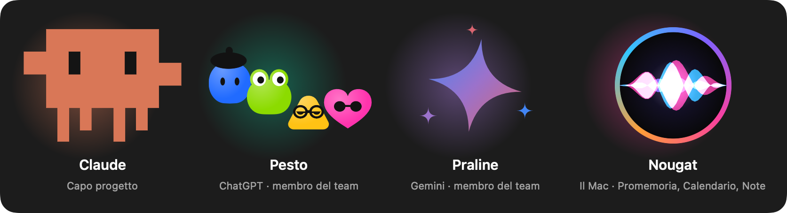
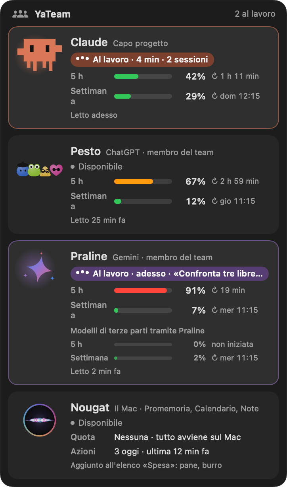

# YaTeam

[English](README.md) · [Français](README.fr.md) · [Deutsch](README.de.md) · [Español](README.es.md) · **Italiano** · [日本語](README.ja.md) · [中文](README.zh.md)



**Claude diventa capo progetto e lavora con ChatGPT, Gemini e il tuo Mac.**

YaTeam collega a Claude gli assistenti che forse hai già. Scegli quali durante l'installazione, e puoi aggiungerne o rimuoverne in seguito:

| | Ruolo | Passa da |
|---|---|---|
| **Claude** | capo progetto: progetta, scrive, decide | l'app Claude o Claude Code |
| **ChatGPT** | membro del team: revisioni, secondo parere, verifiche, immagini | Codex CLI (OpenAI) |
| **Gemini** | membro del team: ricerca web con fonti, sintesi di documenti lunghi, immagini | Antigravity CLI (Google) |
| **Il Mac** | Promemoria, Calendario, Note, aprire app, Apple Intelligence | una piccola app costruita sul tuo Mac, senza comandi rapidi da creare |

Parli con Claude come al solito. Quando serve, delega di sua iniziativa («Chiedo a Praline di verificare le fonti») o su tua richiesta («Chiedi a Pesto di rileggere questo file», «Aggiungi il pane alla mia lista della spesa»). ChatGPT e Gemini lavorano **in sola lettura**: solo Claude modifica i tuoi file, e controlla le loro risposte prima di trasmettertele. Il Mac agisce solo quando glielo chiedi e **non invia mai** messaggi, email o inviti.

Durante l'installazione, ogni membro riceve un **soprannome buffo estratto a caso** (Pesto, Praline, Nougat, Bagel…), che puoi tenere o cambiare. YaTeam parla **7 lingue**: inglese, francese, tedesco, spagnolo, italiano, giapponese e cinese.

## Cosa ottieni

- **Un connettore «equipe»** per l'app Claude (Chat, Cowork, scheda Code) e per Claude Code nel Terminale: affidare un compito a ChatGPT o a Gemini, creare un'immagine e salvarla nella cartella del progetto, recuperare una risposta più tardi (i compiti lunghi non bloccano Claude), consultare le quote del team, e gli strumenti del Mac.
- **Il membro Mac** (facoltativo): leggere, completare e spuntare i tuoi elenchi di Promemoria, aggiungere un evento al Calendario (senza mai leggere il tuo calendario), creare una nota, aprire un'app, fare una domanda rapida ad Apple Intelligence (elaborata sul Mac, nulla ne esce). Nessun comando rapido da creare.
- **Un agente per membro del team per Claude Code**, per affidare loro compiti dal Terminale.
- **Una regola di delega** in `~/.claude/CLAUDE.md`, perché Claude pensi a delegare senza che glielo si chieda.
- **Un pannello** (facoltativo), sulla scrivania o in primo piano: la quota usata da ciascuno su 5 ore e sulla settimana, l'ora di azzeramento, chi sta lavorando e le azioni del giorno del Mac, con un piccolo personaggio animato per membro.



## Requisiti

- **Un Mac** con macOS 14 (Sonoma) o successivo.
- **Gli strumenti a riga di comando di Apple** (gratuiti, per Python e Swift). Se mancano, il programma di installazione propone di installarli; l'app Xcode non serve.
- **Claude**: l'[app Claude per desktop](https://claude.ai/download) e/o [Claude Code](https://claude.com/claude-code), con il tuo abbonamento Claude.
- **Almeno un membro**:
  - **ChatGPT**: il [Codex CLI ufficiale di OpenAI](https://developers.openai.com/codex/cli), per esempio `brew install --cask codex` con [Homebrew](https://brew.sh), oppure `npm install -g @openai/codex`. Avvia `codex` una volta nel Terminale, accedi con il tuo account ChatGPT, poi esci (`Ctrl + C`). Un account gratuito basta per piccoli compiti; un abbonamento dà molta più quota.
  - **Gemini**: l'[Antigravity CLI ufficiale di Google](https://antigravity.google) (programma `agy`), per esempio `brew install --cask antigravity-cli`. Avvia `agy` una volta, accedi con il tuo account Google, poi esci (`Ctrl + C`). *Gemini CLI non accetta più gli account personali da giugno 2026: per questo YaTeam passa da Antigravity.*
  - **Il Mac**: niente da installare. Per le domande ad Apple Intelligence: un Mac con chip Apple, macOS 26 o successivo e Apple Intelligence attiva.
- **Per seguire Claude nel pannello** (la sua quota e quando lavora): Claude Code. Con la sola app Claude tutto funziona, ma il pannello non mostra Claude.

## Installazione con doppio clic

1. **Scarica [YaTeam.zip](../../releases/latest/download/YaTeam.zip)** (ultima versione). Fai doppio clic sul file .zip per decomprimerlo.
2. Nella cartella decompressa, **fai doppio clic su «Installer YaTeam»**.
3. **La prima volta macOS lo blocca** (file scaricato, non firmato con un account sviluppatore Apple). Chiudi il messaggio, apri **Impostazioni di Sistema > Privacy e sicurezza**, scorri fino al messaggio su «Installer YaTeam» e fai clic su **Apri comunque**; conferma (password o Touch ID) e fai clic su **Apri**. Va fatto una sola volta.
4. **Rispondi alle domande** che compaiono nelle finestre: la lingua, le IA da aggiungere al team (una domanda per IA; quelle non installate sul tuo Mac non vengono proposte), i soprannomi, il pannello. Un riepilogo dice cosa verrà fatto; fai clic su **Installa**. I dettagli scorrono nella finestra del Terminale.
5. **Se hai aggiunto il Mac**, macOS chiede per «YaTeam Mac» l'accesso ai tuoi **Promemoria**, al tuo **Calendario** (solo aggiunta di eventi) e poi il controllo di **Note**: rispondi **Consenti** o **OK** ogni volta.
6. Alla fine, **chiudi completamente l'app Claude (`Cmd + Q`) e riaprila**, e apri una nuova sessione di Claude Code.

Ogni file modificato viene prima salvato in `~/.claude/equipe/sauvegardes/<data>/` (leggibile solo da te). Un file di impostazioni illeggibile non viene mai sovrascritto: il programma lo segnala e prosegue. Gli altri hook, connettori e impostazioni restano intatti.

**Se macOS rifiuta di aprire il file** (per esempio perché i permessi si sono persi nella decompressione): apri l'app **Terminale**, scrivi `cd` seguito da uno spazio, trascina la cartella decompressa nella finestra, premi Invio, poi avvia `./install.sh` (le domande vengono allora poste nel Terminale).

### Come Claude scopre il team

- **Il connettore «equipe»**: a ogni avvio presenta a Claude i membri scelti, i loro soprannomi e i loro strumenti, e gli dice quando delegare. Per questo va riaperta l'app Claude dopo l'installazione.
- **La regola in `~/.claude/CLAUDE.md`**, letta da Claude Code a ogni sessione.
- **Gli agenti** di Claude Code (uno per membro del team).

### Installazione nel Terminale

`./install.sh` pone le domande nel Terminale e chiede il tuo consenso prima di ogni passo (`s` sì, `n` no, `tutto` accettare tutto). Opzioni:

| Opzione | Effetto |
|---|---|
| `--ai chatgpt,gemini,mac` | i membri da attivare (gli altri vengono rimossi) |
| `--language it` | lingua: `en` `fr` `de` `es` `it` `ja` `zh` |
| `--chatgpt-name Bagel` `--gemini-name Nori` `--mac-name Mango` | scegliere i soprannomi |
| `--new-names` | estrarre nuovi soprannomi a caso |
| `--yes` | accettare tutto |
| `--no-widget` | non proporre il pannello |
| `--windows` | le domande in finestre (è ciò che fa il doppio clic) |

I soprannomi sono estratti da [`outils/noms.txt`](outils/noms.txt), un elenco verificato nelle 7 lingue (nessun significato imbarazzante, nessun personaggio o prodotto noto).

## Aggiungere o rimuovere un'IA, cambiare la lingua o i soprannomi

- Nel pannello: **clic destro → Impostazioni… → Modifica il team…**
- Oppure fai doppio clic su **«Modifica YaTeam»** in `~/.claude/equipe/kit` (una copia del kit conservata dall'installazione: puoi cancellare la cartella scaricata).
- Oppure riapri **«Installer YaTeam»** dalla cartella scaricata.

Compaiono le stesse finestre, con le tue scelte attuali. Poi chiudi e riapri l'app Claude.

## Uso

Alcuni esempi da dire a Claude (con i soprannomi del tuo team):

- «Chiedi a Praline di trovare le tre migliori fonti recenti su questo argomento.»
- «Fai rileggere questo file a Pesto prima di consegnarlo.»
- «Affida la ricerca a Praline senza aspettarla, e intanto scrivi il piano.»
- «Fai preparare un'illustrazione per la home page e salvala nella cartella Images del progetto.»
- «Cosa c'è nella mia lista della spesa? Aggiungi il pane e spunta il latte.»
- «Metti l'allestimento di giovedì, dalle 8 alle 18, nel mio calendario.»
- «Crea una nota con questo riassunto.» · «Apri la Calcolatrice.»
- «A che punto sono le quote del team?»

Nella scheda Chat dell'app Claude, indica la cartella del Mac interessata (per esempio «in ~/Documents/MioProgetto») quando il compito riguarda i tuoi file o un'immagine da salvare. Per lavorare senza il team, di' «senza il team».

In Claude Code, la prima volta che un agente avvia un membro del team, Claude Code può chiederti il permesso di eseguire il suo script (`~/.claude/equipe/codex.sh` o `antigravity.sh`).

## Il membro Mac

Passa da **«YaTeam Mac»**, una piccola app senza finestra costruita sul tuo Mac durante l'installazione (sorgenti in [`mac/`](mac/)): nessun comando rapido da creare o importare. Ha le proprie autorizzazioni, elencate in **Impostazioni di Sistema > Privacy e sicurezza**:

- **Promemoria**: leggere i tuoi elenchi, aggiungere elementi (con scadenza se vuoi), spuntarli o togliere la spunta. Viene spuntato solo un nome esatto; un nome solo simile viene proposto, mai spuntato. Non viene mai eliminato nulla.
- **Calendari, solo aggiunta**: YaTeam aggiunge gli eventi che chiedi, senza invitare nessuno, e **non legge mai il tuo calendario**.
- **Note**, tramite «Automazione»: creare le note che chiedi, senza leggere le altre.
- **Niente immagini**: Image Playground non lascia disegnare le app; le immagini passano da ChatGPT o Gemini.
- **Apple Intelligence** (Mac con chip Apple, macOS 26 o successivo): domande rapide elaborate sul Mac, senza web né file.

Claude crea promemoria, eventi o note quando glielo chiedi; altrimenti lo propone e aspetta il tuo sì. Ogni azione riuscita viene annotata in un **registro locale** (`~/.claude/equipe/etat/journal-mac.txt`, leggibile solo da te), che Claude rilegge per verificare che un'azione sia andata a buon fine. Il testo delle tue domande ad Apple Intelligence non viene copiato lì.

## Il pannello


Un pannello (spostabile, su tutte le scrivanie) e un'icona nella barra dei menu. Per ogni membro: quota usata su 5 h e sulla settimana, ora di azzeramento, «Al lavoro» con la durata e il compito in corso, oppure «In attesa della tua risposta» quando Claude aspetta un'autorizzazione. Per il Mac: le azioni del giorno e l'ultima.

**Clic destro → Impostazioni…**:

- **Connessioni**: «Riconnetti…» apre il Terminale sul comando di accesso ufficiale di Claude Code, Codex o Antigravity, con le istruzioni.
- **Team**: «Modifica il team…» (aggiungere o rimuovere un'IA, lingua, soprannomi).
- **Il Mac**: Apple Intelligence, il registro e le autorizzazioni.
- **Visualizzazione**: schede nascondibili, pannello **sulla scrivania** (dietro le finestre, predefinito) o **in primo piano** sopra di esse, posizione, apertura al login.
- **Letture delle quote**: ogni quanto si leggono le quote di Claude e di Gemini.
- **Avvisi**: una notifica quando una quota supera il 75, l'80 o il 90 %.

Da dove vengono i numeri (nessuna chiamata al modello, quindi nessuna quota consumata):

| | Quota | Attività |
|---|---|---|
| Claude | `claude -p /usage` (comando ufficiale di Claude Code) | hook di Claude Code |
| ChatGPT | contatori che Codex scrive in `~/.codex/sessions` | script del membro del team |
| Gemini | `agy -p /quota` (comando ufficiale di Antigravity) | script del membro del team |
| Il Mac | nessuna quota | connettore (`~/.claude/equipe/etat/mac.json`) |

Se Antigravity chiede di accedere di nuovo a Google, YaTeam **non apre mai da solo una pagina di accesso**: un «open» finto blocca la richiesta, le letture di Gemini vanno in pausa e il pannello te lo dice. Accedi di nuovo con «Riconnetti…», poi fai clic su «Aggiorna».

Costruire il pannello a mano: `./widget/outils/construire.sh --installer`. È firmato «ad hoc» (senza account sviluppatore Apple): costruito sul tuo Mac, si apre senza avvisi. Per firmarlo con il tuo certificato Developer ID: `YATEAM_IDENTITE="Developer ID Application: …" ./widget/outils/construire.sh --installer`.

## Privacy e sicurezza

- YaTeam **avvia solo i programmi ufficiali** (`claude`, `codex`, `agy`) che hai installato e connesso tu, più la sua piccola app «YaTeam Mac». **Non legge, non conserva e non trasmette mai** password, token o credenziali.
- Nessun server, nessuna statistica, nessuna telemetria. Un compito affidato a ChatGPT o a Gemini va a OpenAI o a Google; ciò che Claude legge (i tuoi file, i tuoi Promemoria) fa parte della tua conversazione con Claude. Le domande ad Apple Intelligence restano sul Mac.
- **Sola lettura**:
  - ChatGPT gira nella sandbox in sola lettura di Codex (`codex exec -s read-only`), imposta dal sistema;
  - Gemini gira in modalità non interattiva (`agy --sandbox -p`): con le impostazioni predefinite, Antigravity rifiuta da solo ogni azione che richiede un'autorizzazione, e un'istruzione gli ricorda di non modificare nulla. È una protezione di Antigravity, non un blocco del sistema: se lo hai impostato per approvare tutto automaticamente, non vale più.
- **Il Mac**: nessuno strumento invia messaggi, email o inviti; il Calendario è in sola aggiunta; in Promemoria non viene eliminato nulla.
- Le immagini possono essere salvate solo nella tua cartella utente, fuori dalle cartelle nascoste e da Library, e non sovrascrivono mai un file esistente.
- Non affidare mai password, chiavi o dati riservati in un incarico.

## In caso di problemi

- **macOS blocca «Installer YaTeam»**: vedi il passo 3 dell'installazione (Impostazioni di Sistema > Privacy e sicurezza > Apri comunque).
- **Claude non conosce il team nell'app Claude**: chiudi completamente l'app (`Cmd + Q`) e riaprila. La prima volta che Claude usa uno strumento del team, l'app può chiederti l'autorizzazione.
- **«non è riuscito a rispondere (quota esaurita o accesso scaduto?)»**: avvia `codex` o `agy` nel Terminale per verificare l'accesso, oppure aspetta l'azzeramento della quota (visibile nel pannello).
- **«Antigravity richiede di accedere nuovamente a Google»**: impostazioni del pannello → Riconnetti… (oppure avvia `agy` nel Terminale), poi «Aggiorna».
- **Il Mac non legge i tuoi Promemoria**: Impostazioni di Sistema > Privacy e sicurezza > Promemoria > attiva «YaTeam Mac» (lo stesso per Calendari; per Note: Automazione > «YaTeam Mac»).
- **La quota di ChatGPT indica «Ancora nessuna lettura»**: è normale prima del suo primo compito.
- Il registro del connettore si trova in `~/Library/Logs/Claude/mcp-server-equipe.log` (Finder: Vai → Vai alla cartella).

## Limiti

- **Solo macOS.** Niente video: solo immagini fisse.
- **La quota gratuita di ChatGPT è bassa**: uno o due compiti brevi ogni 5 ore. La regola di delega chiede allora a Claude di passare da Gemini.
- **Apple Intelligence** richiede un Mac con chip Apple, macOS 26 o successivo e Apple Intelligence attiva. Il Mac non disegna: le immagini passano da ChatGPT o Gemini.
- «YaTeam Mac» è firmata «ad hoc»: se una nuova versione di YaTeam cambia i suoi sorgenti, il programma di installazione la ricostruisce e macOS chiede di nuovo le sue autorizzazioni (Promemoria, Calendario, Note) (altrimenti non cambia nulla).
- Un compito viene interrotto dopo 15 minuti. Una risposta non recuperata viene dimenticata dopo un'ora, e i compiti in corso si perdono se l'app Claude si chiude.
- Le letture delle quote si basano su output di `claude`, `codex` e `agy` che non sono interfacce pubbliche: un aggiornamento può cambiarli. Il pannello mostra allora «Dati illeggibili» invece di un numero sbagliato.
- I nomi degli strumenti sono gli stessi in tutte le lingue (`confier_a_…`, `mac_…`, `faire_une_image`, `attendre_reponse`, `quotas_equipe`): le loro descrizioni sono tradotte.

## Avvertenza

YaTeam è uno **strumento non ufficiale**, sviluppato in modo indipendente, per **uso personale**. Non è affiliato ad Anthropic, OpenAI, Google o Apple, né approvato da loro. Claude e Claude Code sono marchi di Anthropic; ChatGPT e Codex, di OpenAI; Gemini e Antigravity, di Google; macOS, Apple Intelligence, Image Playground e Swift, di Apple. Le icone del pannello sono disegni fatti in casa che richiamano ciascun assistente; non sono i loro loghi ufficiali.

Avvia sul tuo Mac solo i programmi ufficiali che hai installato tu, con il tuo account. **Resti responsabile del rispetto delle condizioni d'uso di ciascun fornitore** (abbonamenti, limiti di utilizzo, regole sull'automazione). Software fornito «così com'è», senza garanzia (vedi la [licenza](LICENSE)).

## Disinstallazione

Fai doppio clic su **«Disinstalla YaTeam»** in `~/.claude/equipe/kit` (una sola conferma), oppure avvia nel Terminale:

```bash
./desinstaller.sh
```

Rimuove esattamente ciò che l'installazione ha aggiunto (hook, connettore dell'app Claude e di Claude Code, agenti, regola, pannello), con una copia di sicurezza di ogni file modificato. La cartella `~/.claude/equipe` (con le copie di sicurezza, la copia del kit e l'app YaTeam Mac) e il pannello vanno nel Cestino. Codex CLI, Antigravity CLI e Claude Code restano installati: non fanno parte di YaTeam.

## Per chi contribuisce

```
Installer YaTeam.command   installazione con doppio clic (install.sh --windows)
equipe/           script copiati in ~/.claude/equipe: connettore MCP (Python 3.9 senza dipendenze;
                  moduli noyau, garde, mac, images), script dei membri, hook di Claude Code
equipe/langues/   traduzioni (fr.json fa da riferimento; i valori {nome} li inserisce il codice)
mac/              «YaTeam Mac» (Swift: EventKit, AppleScript, FoundationModels)
modeles/<codice>/ modelli degli agenti di Claude Code e della regola di delega, per lingua
outils/           configurer.py (modifiche prudenti a JSON e CLAUDE.md), noms.txt (soprannomi)
widget/           pannello SwiftUI (pacchetto Swift, senza Xcode) e i suoi script di costruzione
tests/            test senza rete né quota: codex, agy, claude, YaTeam Mac e finestre finti,
                  cartella utente temporanea
```

Avviare i test (non toccano mai la tua vera cartella utente, non compilano nulla e non aprono finestre):

```bash
./tests/lancer_tests.sh
```

**Aggiungere una lingua**: copia `equipe/langues/en.json` e `modeles/en/` con il nuovo codice, traducili, aggiungi il codice agli elenchi di `equipe/textes.py`, `install.sh` e `widget/Sources/Donnees/Textes.swift`, e una cartella `<codice>.lproj` in `mac/YaTeamMac/`, poi avvia i test (verificano che ogni chiave e ogni `{valore}` siano presenti).

Immagini del README: `./widget/outils/instantanes.sh` (il pannello disegna le sue viste in file PNG con dati dimostrativi, in ogni lingua, senza finestre).

**Pubblicare una versione**: crea lo zip con `ditto -c -k --keepParent yateam yateam.zip` (mantiene i permessi di esecuzione) e provalo su un nuovo account macOS prima di pubblicarlo: download, sblocco di Gatekeeper, installazione con doppio clic, autorizzazioni del Mac, poi disinstallazione.

## Licenza

[MIT](LICENSE).
