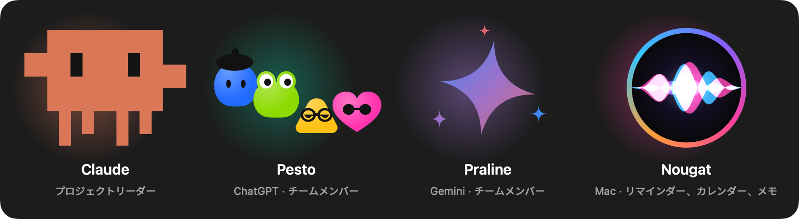
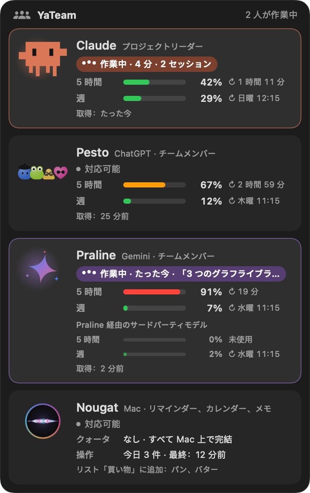
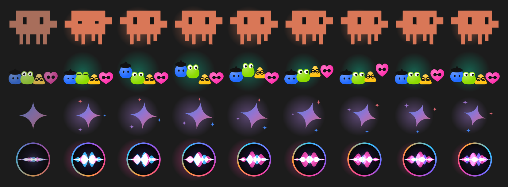

# YaTeam

[English](README.md) · [Français](README.fr.md) · [Deutsch](README.de.md) · [Español](README.es.md) · [Italiano](README.it.md) · **日本語** · [中文](README.zh.md)



**Claude がプロジェクトリーダーになり、ChatGPT、Gemini、そしてあなたの Mac と一緒に働きます。**

YaTeam は、あなたがすでに使っているかもしれないアシスタントを Claude につなぎます。どれを使うかはインストール時に選べ、あとから追加や削除もできます：

| | 役割 | 経由するもの |
|---|---|---|
| **Claude** | プロジェクトリーダー：設計、執筆、判断 | Claude アプリまたは Claude Code |
| **ChatGPT** | チームメンバー：レビュー、セカンドオピニオン、確認、画像 | Codex CLI（OpenAI） |
| **Gemini** | チームメンバー：出典付きの Web 調査、大きな文書の要約、画像 | Antigravity CLI（Google） |
| **Mac** | リマインダー、カレンダー、メモ、アプリを開く、Apple Intelligence | あなたの Mac 上でビルドされる小さなアプリ（ショートカットの作成は不要） |

いつものように Claude と話すだけです。役に立つときは Claude が自分から委任し（「Praline に出典を確認してもらいます」）、頼めばそのとおりにします（「Pesto にこのファイルをレビューしてもらって」「買い物リストにパンを追加して」）。ChatGPT と Gemini は**読み取り専用**で動きます。ファイルを変更するのは Claude だけで、回答は伝える前に Claude が確認します。Mac は頼まれたときだけ動き、メッセージ、メール、招待を**一切送信しません**。

インストール時に、各メンバーには**ランダムな楽しいニックネーム**（Pesto、Praline、Nougat、Bagel など）が付きます。そのまま使っても、変更してもかまいません。YaTeam は**7 言語**に対応しています：英語、フランス語、ドイツ語、スペイン語、イタリア語、日本語、中国語。

## できること

- **コネクタ「equipe」**：Claude アプリ（チャット、Cowork、Code タブ）とターミナルの Claude Code で使えます。ChatGPT や Gemini にタスクを任せる、画像を作ってプロジェクトのフォルダに保存する、回答を後で受け取る（長いタスクでも Claude は止まりません）、チームのクォータを確認する、そして Mac のツール。
- **Mac メンバー**（任意）：リマインダーのリストを読む、項目を追加する、チェックする、カレンダーに予定を追加する（予定表を読むことはありません）、メモを作る、アプリを開く、Apple Intelligence に短い質問をする（Mac 上で処理され、外には出ません）。ショートカットの作成は不要です。
- **チームメンバーごとの Claude Code エージェント**：ターミナルからタスクを任せられます。
- **委任ルール**：`~/.claude/CLAUDE.md` に追加され、頼まれなくても Claude が委任を考えるようになります。
- **パネル**（任意）：デスクトップ上またはフローティング表示で、各メンバーの 5 時間と 1 週間のクォータ使用率、リセット時刻、作業中のメンバー、Mac の今日の操作を、メンバーごとの小さなアニメーションキャラクターと一緒に表示します。



## 必要なもの

- **Mac**：macOS 14（Sonoma）以降。
- **Apple のコマンドラインツール**（無料、Python と Swift 用）。入っていない場合はインストーラが追加を提案します。Xcode アプリは不要です。
- **Claude**：[Claude デスクトップアプリ](https://claude.ai/download) と／または [Claude Code](https://claude.com/claude-code)、そして Claude のサブスクリプション。
- **少なくとも 1 人のメンバー**：
  - **ChatGPT**：OpenAI 公式の [Codex CLI](https://developers.openai.com/codex/cli)。たとえば [Homebrew](https://brew.sh) で `brew install --cask codex`、または `npm install -g @openai/codex`。ターミナルで `codex` を一度実行し、ChatGPT アカウントでサインインしてから終了します（`Ctrl + C`）。小さなタスクなら無料アカウントでも足ります。サブスクリプションならクォータがずっと多くなります。
  - **Gemini**：Google 公式の [Antigravity CLI](https://antigravity.google)（プログラム名 `agy`）。たとえば `brew install --cask antigravity-cli`。`agy` を一度実行し、Google アカウントでサインインしてから終了します（`Ctrl + C`）。*Gemini CLI は 2026 年 6 月から個人アカウントに対応しなくなったため、YaTeam は Antigravity を使います。*
  - **Mac**：インストール不要。Apple Intelligence への質問には、Apple シリコン搭載の Mac、macOS 26 以降、Apple Intelligence の有効化が必要です。
- **パネルで Claude を表示するには**（クォータと作業状況）：Claude Code が必要です。Claude アプリだけでもすべて動きますが、パネルに Claude は表示されません。

## ダブルクリックでインストール

1. このリポジトリを**ダウンロード**します：緑の「Code」ボタン →「Download ZIP」。.zip ファイルをダブルクリックして展開します。
2. 展開したフォルダで **「Installer YaTeam」をダブルクリック**します。
3. **初回は macOS がブロックします**（ダウンロードしたファイルで、Apple の開発者アカウントで署名されていないため）。メッセージを閉じてから **システム設定 > プライバシーとセキュリティ** を開き、「Installer YaTeam」についてのメッセージまでスクロールして **このまま開く** をクリックし、確認（パスワードまたは Touch ID）してから **開く** をクリックします。これは一度だけです。
4. ウィンドウに表示される**質問に答えます**：言語、チームに加える AI（AI ごとに 1 つの質問。Mac にインストールされていないものは表示されません）、ニックネーム、パネル。実行内容のまとめが表示されたら **インストール** をクリックします。詳細はターミナルのウィンドウに表示されます。
5. **Mac を追加した場合**、macOS が「YaTeam Mac」に**リマインダー**、**カレンダー**（予定の追加のみ）へのアクセスと、**メモ** の制御の許可を求めます。それぞれ **許可** または **OK** を選んでください。
6. 最後に、**Claude アプリを完全に終了（`Cmd + Q`）してから開き直し**、Claude Code の新しいセッションを開きます。

変更するファイルはすべて、事前に `~/.claude/equipe/sauvegardes/<日付>/` にバックアップされます（あなただけが読めます）。読み取れない設定ファイルは決して上書きされず、インストーラがそれを知らせて次に進みます。ほかのフック、コネクタ、設定はそのまま残ります。

**macOS がファイルを開けない場合**（展開時に権限が失われた場合など）：**ターミナル** アプリを開き、`cd` とスペースを入力し、展開したフォルダをウィンドウにドラッグして Return キーを押してから、`./install.sh` を実行します（質問はターミナルで行われます）。

### Claude がチームを知る仕組み

- **コネクタ「equipe」**：起動するたびに、選んだメンバー、ニックネーム、ツールを Claude に紹介し、いつ委任すべきかを伝えます。インストール後に Claude アプリを開き直すのはこのためです。
- **`~/.claude/CLAUDE.md` のルール**：Claude Code がセッションごとに読みます。
- **Claude Code のエージェント**（チームメンバーごとに 1 つ）。

### ターミナルでインストール

`./install.sh` はターミナルで質問し、各ステップの前に確認します（`はい`、`いいえ`、`すべて` ですべて承諾）。オプション：

| オプション | 効果 |
|---|---|
| `--ai chatgpt,gemini,mac` | 有効にするメンバー（それ以外は削除） |
| `--language ja` | 言語：`en` `fr` `de` `es` `it` `ja` `zh` |
| `--chatgpt-name Bagel` `--gemini-name Nori` `--mac-name Mango` | ニックネームを選ぶ |
| `--new-names` | ニックネームを新しく抽選する |
| `--yes` | すべて承諾 |
| `--no-widget` | パネルを提案しない |
| `--windows` | 質問をウィンドウで行う（ダブルクリック時と同じ） |

ニックネームは [`outils/noms.txt`](outils/noms.txt) から選ばれます。7 言語すべてで確認済みのリストです（気まずい意味や、有名なキャラクター・製品の名前はありません）。

## AI の追加・削除、言語やニックネームの変更

- パネルで：**右クリック → 設定… → チームを変更…**
- または `~/.claude/equipe/kit` にある **「YaTeam を変更」** をダブルクリックします（インストール時に保存されたキットのコピーなので、ダウンロードしたフォルダは削除してかまいません）。
- または、ダウンロードしたフォルダから **「Installer YaTeam」** をもう一度開きます。

現在の選択内容で、同じウィンドウが表示されます。その後、Claude アプリを終了してから開き直してください。

## 使い方

Claude への話しかけ方の例（あなたのチームのニックネームで）：

- 「Praline に、このテーマについての最近の良い出典を 3 つ探してもらって。」
- 「納品する前に、このファイルを Pesto にレビューしてもらって。」
- 「調査は待たずに Praline に任せて、その間に計画を書いて。」
- 「トップページ用のイラストを作って、プロジェクトの Images フォルダに保存して。」
- 「買い物リストには何がある？ パンを追加して、牛乳はチェックして。」
- 「木曜日の設営、8 時から 18 時までをカレンダーに入れて。」
- 「この要約でメモを作って。」・「計算機を開いて。」
- 「チームのクォータはどう？」

Claude アプリのチャットタブでは、ファイルに関するタスクや保存する画像があるときは、Mac のフォルダを指定してください（例：「~/Documents/MyProject の中で」）。チームを使わずに作業したいときは「チームなしで」と言ってください。

Claude Code では、エージェントが初めてチームメンバーを起動するとき、そのスクリプト（`~/.claude/equipe/codex.sh` または `antigravity.sh`）の実行許可を求められることがあります。

## Mac メンバー

インストール時にあなたの Mac 上でビルドされる、ウィンドウのない小さなアプリ **「YaTeam Mac」** を通じて動きます（ソースは [`mac/`](mac/)）。ショートカットの作成やインポートは不要です。独自の権限を持ち、**システム設定 > プライバシーとセキュリティ** で確認できます：

- **リマインダー**：リストを読む、項目を追加する（必要なら期限付きで）、チェックする・チェックを外す。チェックされるのは完全に一致する名前だけで、似ているだけの名前は候補として示され、チェックはされません。削除は一切しません。
- **カレンダー（追加のみ）**：頼まれた予定を、誰も招待せずに追加します。**予定表を読むことはありません**。
- **メモ**（「オートメーション」による）：頼まれたメモを作成します。ほかのメモは読みません。
- **画像なし**：Image Playground はアプリによる画像生成を受け付けていないため、画像は ChatGPT または Gemini が担当します。
- **Apple Intelligence**（Apple シリコン搭載の Mac、macOS 26 以降）：Mac 上で処理される短い質問。Web やファイルは使いません。

リマインダー、予定、メモは、頼まれたときに Claude が作成します。それ以外のときは提案して、あなたの「はい」を待ちます。成功した操作はすべて**ローカルのログ**（`~/.claude/equipe/etat/journal-mac.txt`、あなただけが読めます）に記録され、Claude は操作が完了したかをこれで確認します。Apple Intelligence への質問の本文はそこに書き込まれません。

## パネル



パネル（移動可能、すべてのデスクトップに表示）とメニューバーのアイコン。各メンバーについて：5 時間と 1 週間の使用率、リセット時刻、作業時間と作業中のタスク付きの「作業中」、または Claude が許可を待っているときの「返事を待っています」。Mac については、今日の操作と最後の操作。

**右クリック → 設定…**：

- **接続**：「再接続…」で、Claude Code、Codex、Antigravity の公式サインインコマンドが案内付きでターミナルに開きます。
- **チーム**：「チームを変更…」（AI の追加・削除、言語、ニックネーム）。
- **Mac**：Apple Intelligence、ログと権限へのリンク。
- **表示**：カードの表示・非表示、パネルを**デスクトップ上**（ウィンドウの背面、既定）に置くか**フローティング**（ウィンドウの前面）にするか、位置、ログイン時に開く。
- **クォータの取得**：Claude と Gemini のクォータを取得する間隔。
- **アラート**：クォータが 75、80、90% を超えたときの通知。

数値の出どころ（モデルは呼び出さないので、クォータは消費しません）：

| | クォータ | 作業状況 |
|---|---|---|
| Claude | `claude -p /usage`（Claude Code の公式コマンド） | Claude Code のフック |
| ChatGPT | Codex が `~/.codex/sessions` に自分で書き込むカウンター | チームメンバーのスクリプト |
| Gemini | `agy -p /quota`（Antigravity の公式コマンド） | チームメンバーのスクリプト |
| Mac | クォータなし | コネクタ（`~/.claude/equipe/etat/mac.json`） |

Antigravity が Google への再サインインを求めても、YaTeam が**自分からサインインページを開くことはありません**。偽の「open」がその要求を止め、Gemini の取得は一時停止し、パネルがそれを知らせます。「再接続…」でサインインし直してから、「更新」をクリックしてください。

パネルを手動でビルドするには：`./widget/outils/construire.sh --installer`。「アドホック」署名（Apple の開発者アカウントなし）なので、あなたの Mac でビルドすれば警告なしで開きます。自分の Developer ID 証明書で署名するには：`YATEAM_IDENTITE="Developer ID Application: …" ./widget/outils/construire.sh --installer`。

## プライバシーとセキュリティ

- YaTeam が起動するのは、あなた自身がインストールしてサインインした**公式プログラム**（`claude`、`codex`、`agy`）と、小さなアプリ「YaTeam Mac」**だけ**です。パスワード、トークン、ログイン情報を**読む、保存する、送信することは一切ありません**。
- サーバーなし、統計なし、テレメトリーなし。ChatGPT や Gemini に任せたタスクは OpenAI や Google に送られます。Claude が読むもの（ファイルやリマインダー）は Claude との会話の一部になります。Apple Intelligence への質問は Mac に留まります。
- **読み取り専用**：
  - ChatGPT は Codex の読み取り専用サンドボックス（`codex exec -s read-only`）で動き、システムがそれを強制します；
  - Gemini は非対話モード（`agy --sandbox -p`）で動きます。既定の設定では、許可が必要な操作を Antigravity 自身が拒否し、何も変更しないよう指示でも念を押しています。これは Antigravity の保護であり、システムのロックではありません。すべてを自動承認する設定にしている場合は効きません。
- **Mac**：メッセージ、メール、招待を送るツールはありません。カレンダーは追加のみで、リマインダーでは何も削除しません。
- 画像を保存できるのはホームフォルダ内だけ（隠しフォルダとライブラリを除く）で、既存のファイルを上書きすることはありません。
- タスクの指示にパスワード、キー、機密データを入れないでください。

## 困ったときは

- **macOS が「Installer YaTeam」をブロックする**：インストールの手順 3 を参照してください（システム設定 > プライバシーとセキュリティ > このまま開く）。
- **Claude アプリで Claude がチームを知らない**：アプリを完全に終了（`Cmd + Q`）してから開き直してください。Claude が初めてチームのツールを使うとき、アプリが許可を求めることがあります。
- **「回答できませんでした（クォータ切れ、またはサインインの期限切れ？）」**：ターミナルで `codex` または `agy` を実行してサインインを確認するか、クォータのリセットを待ってください（パネルに表示されます）。
- **「Antigravity が Google への再サインインを求めています」**：パネルの設定 → 再接続…（またはターミナルで `agy` を実行）し、そのあと「更新」。
- **Mac がリマインダーを読めない**：システム設定 > プライバシーとセキュリティ > リマインダー で「YaTeam Mac」をオンにします（カレンダーも同様。メモはオートメーション >「YaTeam Mac」）。
- **ChatGPT のクォータが「まだデータがありません」**：最初のタスクの前は正常です。
- コネクタのログは `~/Library/Logs/Claude/mcp-server-equipe.log` にあります（Finder：移動 → フォルダへ移動）。

## 制限

- **macOS のみ。** 動画は不可、静止画のみです。
- **ChatGPT の無料クォータは小さい**：5 時間ごとに短いタスク 1〜2 件。その場合、委任ルールは Claude に Gemini を使うよう求めます。
- **Apple Intelligence** には、Apple シリコン搭載の Mac、macOS 26 以降、Apple Intelligence の有効化が必要です。Mac は画像を作りません。画像は ChatGPT または Gemini が担当します。
- 「YaTeam Mac」は「アドホック」署名です。新しいバージョンの YaTeam でソースが変わると、インストーラが再ビルドし、macOS が権限（リマインダー、カレンダー、メモ）を再度求めます（それ以外は何も変わりません）。
- タスクは 15 分で停止します。受け取られなかった回答は 1 時間後に破棄され、Claude アプリを閉じると実行中のタスクは失われます。
- クォータの取得は、公開インターフェースではない `claude`、`codex`、`agy` の出力に基づいています。アップデートで変わることがあり、その場合パネルは誤った数値ではなく「データを読み取れません」と表示します。
- ツール名はすべての言語で共通です（`confier_a_…`、`mac_…`、`faire_une_image`、`attendre_reponse`、`quotas_equipe`）。説明文は翻訳されています。

## 注意事項

YaTeam は、**個人利用**のために独自に開発された**非公式ツール**です。Anthropic、OpenAI、Google、Apple とは提携しておらず、承認も受けていません。Claude と Claude Code は Anthropic の商標、ChatGPT と Codex は OpenAI の商標、Gemini と Antigravity は Google の商標、macOS、Apple Intelligence、Image Playground、Swift は Apple の商標です。パネルのアイコンは各アシスタントをイメージした手描きのイラストで、公式ロゴではありません。

あなたがインストールした公式プログラムを、あなた自身のアカウントで Mac 上で起動するだけです。**各提供元の利用規約（サブスクリプション、利用上限、自動化に関する規則）を守る責任はあなたにあります。** ソフトウェアは「現状のまま」提供され、保証はありません（[ライセンス](LICENSE) を参照）。

## アンインストール

`~/.claude/equipe/kit` にある **「YaTeam をアンインストール」** をダブルクリックするか（確認は 1 回だけ）、ターミナルで次を実行します：

```bash
./desinstaller.sh
```

インストールで追加したもの（フック、Claude アプリと Claude Code のコネクタ、エージェント、ルール、パネル）だけを正確に取り除き、変更したファイルはすべてバックアップします。`~/.claude/equipe` フォルダ（バックアップ、キットのコピー、YaTeam Mac アプリを含む）とパネルはゴミ箱に入ります。Codex CLI、Antigravity CLI、Claude Code は YaTeam の一部ではないので、インストールされたままです。

## 開発に参加する方へ

```
Installer YaTeam.command   ダブルクリックでのインストール（install.sh --windows）
equipe/           ~/.claude/equipe にコピーされるスクリプト：MCP コネクタ（Python 3.9、依存なし。
                  モジュール noyau、garde、mac、images）、チームメンバーのスクリプト、Claude Code のフック
equipe/langues/   翻訳（fr.json が基準。{名前} の値はコードが挿入）
mac/              「YaTeam Mac」（Swift：EventKit、AppleScript、FoundationModels）
modeles/<code>/   Claude Code のエージェントと委任ルールのテンプレート（言語別）
outils/           configurer.py（JSON と CLAUDE.md の慎重な変更）、noms.txt（ニックネーム）
widget/           SwiftUI のパネル（Swift パッケージ、Xcode 不要）とビルドスクリプト
tests/            ネットワークもクォータも使わないテスト：偽の codex、agy、claude、YaTeam Mac、
                  ウィンドウ、一時的なホームフォルダ
```

テストの実行（本物のホームフォルダには一切触れず、何もコンパイルせず、ウィンドウも開きません）：

```bash
./tests/lancer_tests.sh
```

**言語を追加するには**：`equipe/langues/en.json` と `modeles/en/` を新しい言語コードでコピーして翻訳し、そのコードを `equipe/textes.py`、`install.sh`、`widget/Sources/Donnees/Textes.swift` の一覧に加え、`mac/YaTeamMac/` に `<code>.lproj` フォルダを追加してから、テストを実行します（すべてのキーと `{値}` がそろっているか確認します）。

README の画像：`./widget/outils/instantanes.sh`（パネルがデモ用のデータでビューを PNG に描画します。各言語、ウィンドウなし）。

**リリースを公開するには**：`ditto -c -k --keepParent yateam yateam.zip` で zip を作成し（実行権限が保たれます）、公開前に新しい macOS アカウントで試してください：ダウンロード、Gatekeeper の解除、ダブルクリックでのインストール、Mac の権限、そしてアンインストール。

## ライセンス

[MIT](LICENSE)。
