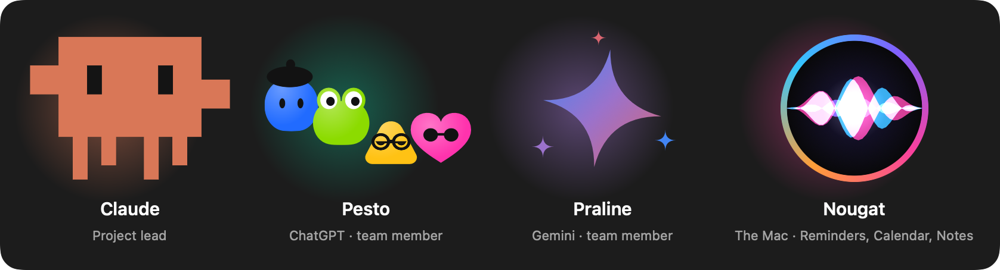
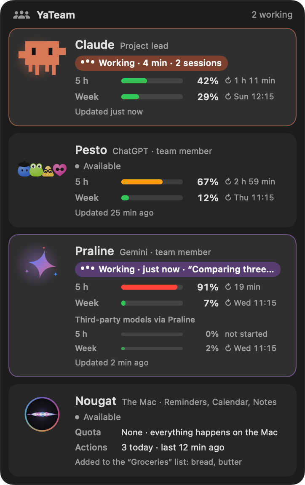

# YaTeam

**English** · [Français](README.fr.md) · [Deutsch](README.de.md) · [Español](README.es.md) · [Italiano](README.it.md) · [日本語](README.ja.md) · [中文](README.zh.md)



**Claude becomes the project lead and works with ChatGPT, Gemini and your Mac.**

YaTeam connects Claude to assistants you may already have. You choose which ones when installing, and you can add or remove them later:

| | Role | Goes through |
|---|---|---|
| **Claude** | project lead: designs, writes, decides | the Claude app or Claude Code |
| **ChatGPT** | team member: reviews, second opinions, checks, images | Codex CLI (OpenAI) |
| **Gemini** | team member: web research with sources, summaries of large documents, images | Antigravity CLI (Google) |
| **The Mac** | Reminders, Calendar, Notes, opening apps, Apple Intelligence | a small app built on your Mac, no shortcut to create |

You talk to Claude as usual. When it helps, Claude delegates on its own (“I'll ask Praline to check the sources”), or when you ask (“Ask Pesto to review this file”, “Add bread to my grocery list”). ChatGPT and Gemini work **read-only**: only Claude changes your files, and it checks their answers before passing them on. The Mac only acts when you ask, and **never sends** messages, emails or invitations.

When installing, each member gets a **funny random nickname** (Pesto, Praline, Nougat, Bagel…), which you can keep or change. YaTeam speaks **7 languages**: English, French, German, Spanish, Italian, Japanese and Chinese.

## What you get

- **An “equipe” connector** for the Claude app (Chat, Cowork, Code tab) and for Claude Code in the Terminal: hand a task to ChatGPT or Gemini, make an image and save it in your project folder, collect an answer later (long tasks never block Claude), check the team's quotas, and the Mac tools.
- **The Mac member** (optional): read, add to and check off your Reminders lists, add an event to your Calendar (never reading your calendar), create a note, open an app, ask Apple Intelligence a quick question (handled on the Mac, nothing leaves it). No shortcut to create.
- **One agent per team member for Claude Code**, to hand them tasks from the Terminal.
- **A delegation rule** in `~/.claude/CLAUDE.md`, so Claude thinks of delegating without being asked.
- **A panel** (optional), on the desktop or floating: each member's quota used over 5 hours and over the week, reset time, who is working, and the Mac's actions of the day, with a small animated character per member.



## Requirements

- **A Mac** running macOS 14 (Sonoma) or later.
- **Apple's Command Line Tools** (free, for Python and Swift). If they are missing, the installer offers to install them; the Xcode app is not needed.
- **Claude**: the [Claude desktop app](https://claude.ai/download) and/or [Claude Code](https://claude.com/claude-code), with your Claude subscription.
- **At least one member**:
  - **ChatGPT**: OpenAI's official [Codex CLI](https://developers.openai.com/codex/cli), for example `brew install --cask codex` with [Homebrew](https://brew.sh), or `npm install -g @openai/codex`. Run `codex` once in Terminal, sign in with your ChatGPT account, then quit (`Ctrl + C`). A free account is enough for small tasks; a subscription gives much more quota.
  - **Gemini**: Google's official [Antigravity CLI](https://antigravity.google) (the `agy` program), for example `brew install --cask antigravity-cli`. Run `agy` once, sign in with your Google account, then quit (`Ctrl + C`). *Gemini CLI no longer accepts personal accounts since June 2026: that is why YaTeam goes through Antigravity.*
  - **The Mac**: nothing to install. For Apple Intelligence questions: a Mac with Apple silicon on macOS 26 or later, with Apple Intelligence turned on.
- **To follow Claude in the panel** (its quota, and when it works): Claude Code. With the Claude app alone everything works, but the panel does not show Claude.

## Double-click installation

1. **Download** this repository: green “Code” button → “Download ZIP”. Double-click the .zip file to unzip it.
2. In the unzipped folder, **double-click “Installer YaTeam”**.
3. **The first time, macOS blocks it** (a downloaded file, not signed by an Apple developer account): “Installer YaTeam” Not Opened. Click **Done**, open **System Settings > Privacy & Security**, scroll down to the message about “Installer YaTeam” and click **Open Anyway**, confirm (password or Touch ID), then click **Open**. You only do this once.
4. **Answer the questions** shown in windows: language, which AIs to add to the team (one question per AI; those not installed on your Mac are not offered), nicknames, the panel. A summary says what will be done; click **Install**. The details scroll in the Terminal window.
5. **If you added the Mac**, macOS asks for “YaTeam Mac” to access your **Reminders**, your **Calendar** (adding events only), then to control **Notes**: answer **Allow** or **OK** each time.
6. At the end, **quit the Claude app completely (`Cmd + Q`) and reopen it**, and start a new Claude Code session.

Every changed file is first backed up in `~/.claude/equipe/sauvegardes/<date>/` (readable by you only). An unreadable settings file is never overwritten: the installer reports it and moves on. Your other hooks, connectors and settings stay untouched.

**If macOS refuses to open the file** (permissions lost while unzipping, for example): open the **Terminal** app, type `cd` followed by a space, drag the unzipped folder into the window, press Return, then run `./install.sh` (the questions are then asked in the Terminal).

### How Claude discovers the team

- **The “equipe” connector**: at every start it presents the chosen members, their nicknames and their tools to Claude, and tells it when to delegate. That is why you reopen the Claude app after installing.
- **The rule in `~/.claude/CLAUDE.md`**, read by Claude Code in every session.
- **The Claude Code agents** (one per team member).

### Installing in the Terminal

`./install.sh` asks its questions in the Terminal and asks before each step (`y` yes, `n` no, `a` accept all). Options:

| Option | Effect |
|---|---|
| `--ai chatgpt,gemini,mac` | the members to enable (the others are removed) |
| `--language de` | language: `en` `fr` `de` `es` `it` `ja` `zh` |
| `--chatgpt-name Bagel` `--gemini-name Nori` `--mac-name Mango` | choose the nicknames |
| `--new-names` | draw new random nicknames |
| `--yes` | accept everything |
| `--no-widget` | do not offer the panel |
| `--windows` | questions in windows (what the double-click does) |

Nicknames are drawn from [`outils/noms.txt`](outils/noms.txt), a list checked in all 7 languages (no awkward meaning, no known character or product).

## Add or remove an AI, change the language or the nicknames

- In the panel: **right-click → Settings… → Change the team…**
- Or double-click **“Modify YaTeam”** in `~/.claude/equipe/kit` (a copy of the kit kept by the installation: you can delete the downloaded folder).
- Or open **“Installer YaTeam”** again from the downloaded folder.

The same windows show up, with your current choices. Then quit and reopen the Claude app.

## Usage

A few examples to say to Claude (with your team's nicknames):

- “Ask Praline to find the three best recent sources on this topic.”
- “Have Pesto review this file before shipping it.”
- “Hand the research to Praline without waiting, and write the plan meanwhile.”
- “Have an illustration made for the home page and save it in the project's Images folder.”
- “What's on my grocery list? Add bread and check off the milk.”
- “Put Thursday's setup, 8 am to 6 pm, in my calendar.”
- “Create a note with this summary.” · “Open Calculator.”
- “How are the team's quotas?”

In the Chat tab of the Claude app, name the Mac folder concerned (for example “in ~/Documents/MyProject”) when the task is about your files or an image to save. To work without the team, say “without the team”.

In Claude Code, the first time an agent starts a team member, Claude Code may ask your permission to run its script (`~/.claude/equipe/codex.sh` or `antigravity.sh`).

## The Mac member

It goes through **“YaTeam Mac”**, a small app without windows built on your Mac during installation (sources in [`mac/`](mac/)): no shortcut to create or import. It has its own permissions, listed in **System Settings > Privacy & Security**:

- **Reminders**: read your lists, add items (with a due date if you like), check or uncheck them. Only an exact name is checked; a name that is only close is suggested, never checked. Nothing is ever deleted.
- **Calendars, adding only**: YaTeam adds the events you ask for, without inviting anyone, and **never reads your calendar**.
- **Notes**, through “Automation”: create the notes you ask for, without reading the others.
- **No images**: Image Playground does not let apps draw; images go through ChatGPT or Gemini.
- **Apple Intelligence** (Mac with Apple silicon, macOS 26 or later): quick questions handled on the Mac, without web or files.

Claude creates reminders, events or notes when you ask; otherwise it suggests it and waits for your yes. Every successful action is written to a **local log** (`~/.claude/equipe/etat/journal-mac.txt`, readable by you only), which Claude reads back to check that an action went through. The text of your Apple Intelligence questions is not copied there.

## The panel


A panel (movable, on all desktops) and an icon in the menu bar. For each member: share used over 5 h and over the week, reset time, “Working” with the duration and current task, or “Waiting for you” when Claude is waiting for a permission. For the Mac: its actions of the day and the last one.

**Right-click → Settings…**:

- **Connections**: “Reconnect…” opens Terminal on the official sign-in command of Claude Code, Codex or Antigravity, with instructions.
- **Team**: “Change the team…” (add or remove an AI, language, nicknames).
- **The Mac**: Apple Intelligence, the log and the permissions.
- **Display**: hideable cards, panel **on the desktop** (behind windows, the default) or **floating** above them, location, open at login.
- **Readings**: how often Claude's and Gemini's quotas are read.
- **Alerts**: a notification when a quota goes over 75, 80 or 90 %.

Where the numbers come from (no model call, so no quota used):

| | Quota | Activity |
|---|---|---|
| Claude | `claude -p /usage` (official Claude Code command) | Claude Code hooks |
| ChatGPT | counters Codex writes itself in `~/.codex/sessions` | the team member's script |
| Gemini | `agy -p /quota` (official Antigravity command) | the team member's script |
| The Mac | no quota | the connector (`~/.claude/equipe/etat/mac.json`) |

If Antigravity asks to sign in to Google again, YaTeam **never opens a sign-in page by itself**: a fake “open” blocks the request, Gemini's readings pause, and the panel tells you. Sign in again with “Reconnect…”, then click “Refresh”.

Build the panel by hand: `./widget/outils/construire.sh --installer`. It is signed “ad hoc” (no Apple developer account): built on your Mac, it opens without warning. To sign it with your Developer ID certificate: `YATEAM_IDENTITE="Developer ID Application: …" ./widget/outils/construire.sh --installer`.

## Privacy and security

- YaTeam **only runs the official programs** (`claude`, `codex`, `agy`) you installed and signed in to yourself, plus its small “YaTeam Mac” app. It **never reads, stores or sends** a password, token or login.
- No server, no statistics, no telemetry. A task handed to ChatGPT or Gemini goes to OpenAI or Google; what Claude reads (your files, your Reminders) is part of your conversation with Claude. Apple Intelligence questions stay on the Mac.
- **Read-only**:
  - ChatGPT runs in Codex's read-only sandbox (`codex exec -s read-only`), enforced by the system;
  - Gemini runs non-interactively (`agy --sandbox -p`): with its default settings, Antigravity refuses any action that needs permission on its own, and an instruction reminds it not to change anything. This is an Antigravity safeguard, not a system lock: if you set it to approve everything automatically, it no longer applies.
- **The Mac**: no tool sends messages, emails or invitations; the Calendar is add-only; nothing is deleted in Reminders.
- Images can only be saved in your home folder, outside hidden folders and Library, and never overwrite an existing file.
- Never put a password, key or confidential data in a task.

## Troubleshooting

- **macOS blocks “Installer YaTeam”**: see step 3 of the installation (System Settings > Privacy & Security > Open Anyway).
- **Claude does not know the team in the Claude app**: quit the app completely (`Cmd + Q`) and reopen it. The first time Claude uses a team tool, the app may ask you to allow it.
- **“could not answer (quota used up or sign-in expired?)”**: run `codex` or `agy` in Terminal to check the sign-in, or wait for the quota reset (shown in the panel).
- **“Antigravity asks to sign in to Google again”**: panel settings → Reconnect… (or run `agy` in Terminal), then “Refresh”.
- **The Mac does not read your Reminders**: System Settings > Privacy & Security > Reminders > turn on “YaTeam Mac” (same for Calendars; for Notes: Automation > “YaTeam Mac”).
- **ChatGPT's quota shows “No data yet”**: normal before its first task.
- The connector's log is in `~/Library/Logs/Claude/mcp-server-equipe.log` (Finder: Go → Go to Folder).

## Limits

- **macOS only.** No video: still images only.
- **ChatGPT's free quota is small**: one or two short tasks per 5-hour window. The delegation rule then asks Claude to go through Gemini.
- **Apple Intelligence** needs a Mac with Apple silicon on macOS 26 or later, with Apple Intelligence turned on. The Mac does not draw: images go through ChatGPT or Gemini.
- “YaTeam Mac” is signed “ad hoc”: if a new version of YaTeam changes its sources, the installer rebuilds it and macOS asks again for its permissions (Reminders, Calendar, Notes) (otherwise nothing changes).
- A task is stopped after 15 minutes. An answer not collected is forgotten after an hour, and running tasks are lost if the Claude app closes.
- Quota readings rely on outputs of `claude`, `codex` and `agy` that are not public interfaces: an update can change them. The panel then shows “Cannot read usage” instead of a wrong number.
- Tool names stay the same in all languages (`confier_a_…`, `mac_…`, `faire_une_image`, `attendre_reponse`, `quotas_equipe`): their descriptions are translated.

## Disclaimer

YaTeam is an **unofficial tool**, developed independently, for **personal use**. It is not affiliated with or endorsed by Anthropic, OpenAI, Google or Apple. Claude and Claude Code are trademarks of Anthropic; ChatGPT and Codex, of OpenAI; Gemini and Antigravity, of Google; macOS, Apple Intelligence, Image Playground and Swift, of Apple. The panel's icons are home-made drawings that evoke each assistant; they are not their official logos.

It only runs, on your Mac, the official programs you installed, with your own account. **You remain responsible for complying with each provider's terms of use** (subscriptions, usage limits, rules on automation). Software provided “as is”, without warranty (see the [license](LICENSE)).

## Uninstalling

Double-click **“Uninstall YaTeam”** in `~/.claude/equipe/kit` (a single confirmation), or run in Terminal:

```bash
./desinstaller.sh
```

It removes exactly what the installation added (hooks, connector of the Claude app and of Claude Code, agents, rule, panel), with a backup of every changed file. The `~/.claude/equipe` folder (with its backups, the kit copy and the YaTeam Mac app) and the panel go to the Trash. Codex CLI, Antigravity CLI and Claude Code stay installed: they are not part of YaTeam.

## For contributors

```
Installer YaTeam.command   double-click installation (install.sh --windows)
equipe/           scripts copied to ~/.claude/equipe: MCP connector (Python 3.9, no dependency;
                  modules noyau, garde, mac, images), team member scripts, Claude Code hook
equipe/langues/   translations (fr.json is the reference; {name} values are inserted by the code)
mac/              “YaTeam Mac” (Swift: EventKit, AppleScript, FoundationModels)
modeles/<lang>/   templates of the Claude Code agents and of the delegation rule, per language
outils/           configurer.py (careful edits of JSON files and CLAUDE.md), noms.txt (nicknames)
widget/           SwiftUI panel (Swift package, no Xcode) and its build scripts
tests/            tests without network or quota: fake codex, agy, claude, YaTeam Mac and windows,
                  temporary home folder
```

Run the tests (they never touch your real home folder, compile nothing and open no window):

```bash
./tests/lancer_tests.sh
```

**Add a language**: copy `equipe/langues/en.json` and `modeles/en/` under the new code, translate them, add the code to the lists in `equipe/textes.py`, `install.sh`, `widget/Sources/Donnees/Textes.swift`, and a `<code>.lproj` folder in `mac/YaTeamMac/`, then run the tests (they check that every key and every `{value}` is present).

README screenshots: `./widget/outils/instantanes.sh` (the panel draws its views into PNG files with demo data, in each language, without a window).

**Publishing a release**: make the zip with `ditto -c -k --keepParent yateam yateam.zip` (it keeps the execute permissions), then try it on a fresh macOS account before publishing: download, Gatekeeper unblocking, double-click installation, Mac permissions, then uninstalling.

## License

[MIT](LICENSE).
