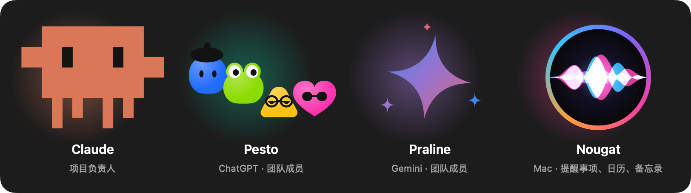
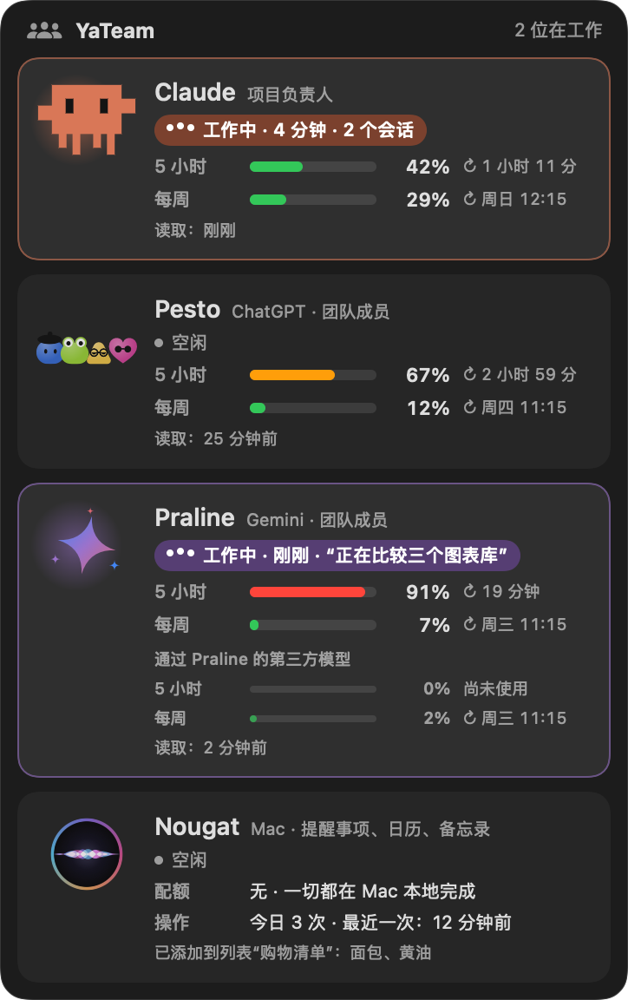

# YaTeam

[English](README.md) · [Français](README.fr.md) · [Deutsch](README.de.md) · [Español](README.es.md) · [Italiano](README.it.md) · [日本語](README.ja.md) · **中文**



**Claude 担任项目负责人，与 ChatGPT、Gemini 和你的 Mac 一起工作。**

YaTeam 把你可能已经在用的助手连接到 Claude。安装时选择要用哪些，之后也可以随时添加或移除：

| | 角色 | 通过 |
|---|---|---|
| **Claude** | 项目负责人：设计、编写、决策 | Claude 应用或 Claude Code |
| **ChatGPT** | 团队成员：审阅、第二意见、核对、图片 | Codex CLI（OpenAI） |
| **Gemini** | 团队成员：带来源的网页调研、大型文档总结、图片 | Antigravity CLI（Google） |
| **Mac** | 提醒事项、日历、备忘录、打开应用、Apple Intelligence | 在你的 Mac 上构建的一个小应用（无需创建快捷指令） |

像平时一样和 Claude 对话即可。在有帮助时，Claude 会主动委派（“我请 Praline 核实一下来源”），也会按你的要求委派（“让 Pesto 审阅这个文件”“把面包加到我的购物清单”）。ChatGPT 和 Gemini 以**只读**方式工作：只有 Claude 会修改你的文件，并且会在转达前核实他们的回答。Mac 只在你要求时才行动，**绝不会发送**信息、邮件或邀请。

安装时，每位成员都会得到一个**随机的有趣昵称**（Pesto、Praline、Nougat、Bagel……），你可以保留，也可以更改。YaTeam 支持 **7 种语言**：英语、法语、德语、西班牙语、意大利语、日语和中文。

## 你会得到什么

- **连接器“equipe”**：适用于 Claude 应用（聊天、Cowork、Code 标签页）和终端中的 Claude Code：把任务交给 ChatGPT 或 Gemini，生成图片并保存到项目文件夹，稍后再取回回答（长任务不会阻塞 Claude），查看团队配额，以及 Mac 的各项工具。
- **Mac 成员**（可选）：读取、补充和勾选你的提醒事项列表，向日历添加日程（绝不读取你的日程），创建备忘录，打开应用，向 Apple Intelligence 快速提问（在 Mac 本地处理，不会离开设备）。无需创建快捷指令。
- **每位团队成员一个 Claude Code 智能体**，方便从终端交办任务。
- **一条委派规则**，写在 `~/.claude/CLAUDE.md` 中，让 Claude 不用提醒也会想到委派。
- **一个面板**（可选），放在桌面上或浮动显示：每个人在 5 小时和一周内的配额用量、重置时间、谁正在工作，以及 Mac 当天的操作，每位成员都有一个小小的动画角色。



## 准备工作

- **一台 Mac**，运行 macOS 14（Sonoma）或更高版本。
- **Apple 命令行工具**（免费，用于 Python 和 Swift）。如果缺少，安装程序会提示安装；不需要 Xcode 应用。
- **Claude**：[Claude 桌面应用](https://claude.ai/download) 和/或 [Claude Code](https://claude.com/claude-code)，以及你的 Claude 订阅。
- **至少一位成员**：
  - **ChatGPT**：OpenAI 官方的 [Codex CLI](https://developers.openai.com/codex/cli)，例如用 [Homebrew](https://brew.sh) 运行 `brew install --cask codex`，或 `npm install -g @openai/codex`。在终端中运行一次 `codex`，用你的 ChatGPT 账户登录，然后退出（`Ctrl + C`）。免费账户足够处理小任务；订阅后配额会多得多。
  - **Gemini**：Google 官方的 [Antigravity CLI](https://antigravity.google)（程序名 `agy`），例如 `brew install --cask antigravity-cli`。运行一次 `agy`，用你的 Google 账户登录，然后退出（`Ctrl + C`）。*自 2026 年 6 月起，Gemini CLI 不再支持个人账户：因此 YaTeam 通过 Antigravity 来使用 Gemini。*
  - **Mac**：无需安装任何东西。向 Apple Intelligence 提问需要：搭载 Apple 芯片的 Mac、macOS 26 或更高版本，并已开启 Apple Intelligence。
- **要在面板中显示 Claude**（它的配额和工作状态）：需要 Claude Code。只用 Claude 应用时一切照常工作，但面板中不会显示 Claude。

## 双击安装

1. **下载 [YaTeam.zip](../../releases/latest/download/YaTeam.zip)**（最新版本）。双击 .zip 文件将其解压。
2. 在解压后的文件夹中，**双击“Installer YaTeam”**。
3. **第一次打开时 macOS 会阻止它**（这是下载的文件，且未用 Apple 开发者账户签名）。关闭提示，打开 **系统设置 > 隐私与安全性**，向下滚动到关于“Installer YaTeam”的提示，点按 **仍要打开**，确认（密码或触控 ID），然后点按 **打开**。只需操作一次。
4. **回答窗口中的问题**：语言、要加入团队的 AI（每个 AI 一个问题；Mac 上未安装的不会出现）、昵称、面板。摘要会说明将要执行的操作；点按 **安装**。详细过程会显示在“终端”窗口中。
5. **如果你添加了 Mac**，macOS 会为“YaTeam Mac”请求访问你的 **提醒事项**、**日历**（仅添加日程），然后请求控制 **备忘录**：每次都请点按 **允许** 或 **好**。
6. 最后，**完全退出 Claude 应用（`Cmd + Q`）再重新打开**，并在 Claude Code 中打开一个新会话。

每个被修改的文件都会先备份到 `~/.claude/equipe/sauvegardes/<日期>/`（只有你能读取）。无法读取的设置文件绝不会被覆盖：安装程序会提示并继续。你的其他钩子、连接器和设置都不会被改动。

**如果 macOS 拒绝打开该文件**（例如解压时丢失了执行权限）：打开 **终端** 应用，输入 `cd` 和一个空格，把解压后的文件夹拖进窗口，按回车键，然后运行 `./install.sh`（问题会在终端中提出）。

### Claude 如何认识团队

- **连接器“equipe”**：每次启动时，它会向 Claude 介绍所选成员、他们的昵称和工具，并告诉 Claude 何时委派。这就是安装后要重新打开 Claude 应用的原因。
- **`~/.claude/CLAUDE.md` 中的规则**：Claude Code 在每个会话中都会读取。
- **Claude Code 智能体**（每位团队成员一个）。

### 在终端中安装

`./install.sh` 会在终端中提问，并在每一步之前征求你的同意（`是`、`否`、`全部` 表示全部接受）。选项：

| 选项 | 作用 |
|---|---|
| `--ai chatgpt,gemini,mac` | 要启用的成员（其余的会被移除） |
| `--language zh` | 语言：`en` `fr` `de` `es` `it` `ja` `zh` |
| `--chatgpt-name Bagel` `--gemini-name Nori` `--mac-name Mango` | 指定昵称 |
| `--new-names` | 重新随机抽取昵称 |
| `--yes` | 全部接受 |
| `--no-widget` | 不提供面板 |
| `--windows` | 在窗口中提问（双击时就是这样） |

昵称从 [`outils/noms.txt`](outils/noms.txt) 中抽取，这份列表已在 7 种语言中检查过（没有尴尬的含义，也没有知名角色或产品的名字）。

## 添加或移除 AI，更改语言或昵称

- 在面板中：**右键点按 → 设置… → 修改团队…**
- 或者双击 `~/.claude/equipe/kit` 中的 **“修改 YaTeam”**（安装时保留的套件副本：你可以删除下载的文件夹）。
- 或者从下载的文件夹中重新打开 **“Installer YaTeam”**。

会出现同样的窗口，并带有你当前的选择。完成后，请退出并重新打开 Claude 应用。

## 使用方法

可以这样对 Claude 说（换成你团队的昵称）：

- “请 Praline 找出这个主题最近最好的三个来源。”
- “交付前让 Pesto 审阅一下这个文件。”
- “把调研交给 Praline，不用等她，同时你先写计划。”
- “为首页做一张插图，并保存到项目的 Images 文件夹。”
- “我的购物清单上有什么？加上面包，把牛奶勾掉。”
- “把周四的搭建，8 点到 18 点，放进我的日历。”
- “用这段总结创建一条备忘录。”·“打开计算器。”
- “团队的配额怎么样了？”

在 Claude 应用的聊天标签页中，如果任务涉及你的文件或要保存图片，请说明 Mac 上的文件夹（例如“在 ~/Documents/MyProject 里”）。不想用团队时，说“不用团队”即可。

在 Claude Code 中，智能体第一次启动某位团队成员时，Claude Code 可能会请你允许运行其脚本（`~/.claude/equipe/codex.sh` 或 `antigravity.sh`）。

## Mac 成员

它通过 **“YaTeam Mac”** 工作：这是安装时在你的 Mac 上构建的一个无窗口小应用（源代码在 [`mac/`](mac/)）：无需创建或导入任何快捷指令。它有自己的权限，可在 **系统设置 > 隐私与安全性** 中查看：

- **提醒事项**：读取你的列表、添加项目（需要时可带截止时间）、勾选或取消勾选。只会勾选名称完全一致的项目；名称仅相近的只会作为候选提示，绝不会被勾选。绝不删除任何内容。
- **日历（仅添加）**：YaTeam 会添加你要求的日程，不邀请任何人，**绝不读取你的日程**。
- **备忘录**（通过“自动化”）：创建你要求的备忘录，不会读取其他备忘录。
- **不生成图片**：Image Playground（图乐园）不允许应用绘图，图片由 ChatGPT 或 Gemini 生成。
- **Apple Intelligence**（搭载 Apple 芯片的 Mac，macOS 26 或更高版本）：在 Mac 本地处理的快速提问，不联网，也不读取文件。

Claude 会在你要求时创建提醒事项、日程或备忘录；否则会先提出建议，等你同意。每次成功的操作都会记入一个**本地日志**（`~/.claude/equipe/etat/journal-mac.txt`，只有你能读取），Claude 用它来确认操作是否完成。你向 Apple Intelligence 提问的内容不会被写进日志。

## 面板


一个面板（可移动，出现在所有桌面上）和菜单栏中的一个图标。对每位成员显示：5 小时和一周内的用量、重置时间、带有时长和当前任务的“工作中”，或在 Claude 等待授权时显示“等待你的回复”。对 Mac 显示：当天的操作和最近一次操作。

**右键点按 → 设置…**：

- **连接**：“重新连接…”会在“终端”中打开 Claude Code、Codex 或 Antigravity 的官方登录命令，并附说明。
- **团队**：“修改团队…”（添加或移除 AI、语言、昵称）。
- **Mac**：Apple Intelligence、日志和权限的快速入口。
- **显示**：可隐藏的卡片，面板**放在桌面上**（位于窗口后方，默认）或**浮动显示**在窗口上方，位置，登录时打开。
- **配额读取**：读取 Claude 和 Gemini 配额的频率。
- **提醒**：配额超过 75%、80% 或 90% 时发送通知。

数字从哪里来（不调用模型，因此不消耗配额）：

| | 配额 | 活动 |
|---|---|---|
| Claude | `claude -p /usage`（Claude Code 官方命令） | Claude Code 钩子 |
| ChatGPT | Codex 自己写在 `~/.codex/sessions` 中的计数器 | 团队成员的脚本 |
| Gemini | `agy -p /quota`（Antigravity 官方命令） | 团队成员的脚本 |
| Mac | 无配额 | 连接器（`~/.claude/equipe/etat/mac.json`） |

如果 Antigravity 要求重新登录 Google，YaTeam **绝不会自行打开登录页面**：一个假的“open”会拦下这个请求，Gemini 的读取会暂停，面板也会告诉你。用“重新连接…”重新登录，然后点按“刷新”。

手动构建面板：`./widget/outils/construire.sh --installer`。它采用“ad hoc”签名（无需 Apple 开发者账户）：在你的 Mac 上构建，打开时不会出现警告。要用你自己的 Developer ID 证书签名：`YATEAM_IDENTITE="Developer ID Application: …" ./widget/outils/construire.sh --installer`。

## 隐私与安全

- YaTeam **只运行你自己安装并登录的官方程序**（`claude`、`codex`、`agy`），以及它的小应用“YaTeam Mac”。它**绝不读取、存储或传送**任何密码、令牌或登录信息。
- 没有服务器，没有统计，没有遥测。交给 ChatGPT 或 Gemini 的任务会发送到 OpenAI 或 Google；Claude 读取的内容（你的文件、你的提醒事项）属于你与 Claude 的对话。向 Apple Intelligence 的提问留在 Mac 上。
- **只读**：
  - ChatGPT 运行在 Codex 的只读沙盒中（`codex exec -s read-only`），由系统强制执行；
  - Gemini 以非交互模式运行（`agy --sandbox -p`）：在默认设置下，Antigravity 会自行拒绝任何需要授权的操作，任务说明也会提醒它不要修改任何东西。这是 Antigravity 的保护，而不是系统锁：如果你把它设为自动批准所有操作，这项保护就不再生效。
- **Mac**：没有任何工具会发送信息、邮件或邀请；日历仅可添加；提醒事项中不会删除任何内容。
- 图片只能保存到你的个人文件夹中（不包括隐藏文件夹和“资源库”），并且绝不会覆盖已有文件。
- 任务说明中绝不要包含密码、密钥或机密数据。

## 遇到问题

- **macOS 阻止了“Installer YaTeam”**：参见安装第 3 步（系统设置 > 隐私与安全性 > 仍要打开）。
- **在 Claude 应用中，Claude 不认识团队**：完全退出应用（`Cmd + Q`）再重新打开。Claude 第一次使用团队工具时，应用可能会请你允许。
- **“无法回答（配额用完或登录已过期？）”**：在终端中运行 `codex` 或 `agy` 检查登录状态，或等待配额重置（面板中可见）。
- **“Antigravity 要求重新登录 Google”**：面板设置 → 重新连接…（或在终端中运行 `agy`），然后点按“刷新”。
- **Mac 读不到你的提醒事项**：系统设置 > 隐私与安全性 > 提醒事项 > 开启“YaTeam Mac”（日历同理；备忘录在 自动化 >“YaTeam Mac”）。
- **ChatGPT 的配额显示“暂无数据”**：在它的第一个任务之前这是正常的。
- 连接器日志位于 `~/Library/Logs/Claude/mcp-server-equipe.log`（访达：前往 → 前往文件夹）。

## 限制

- **仅限 macOS。** 不支持视频：只有静态图片。
- **ChatGPT 的免费配额很小**：每 5 小时一两个简短任务。此时委派规则会让 Claude 改用 Gemini。
- **Apple Intelligence** 需要搭载 Apple 芯片的 Mac、macOS 26 或更高版本，并已开启 Apple Intelligence。Mac 不生成图片：图片由 ChatGPT 或 Gemini 生成。
- “YaTeam Mac”采用“ad hoc”签名：如果新版 YaTeam 修改了它的源代码，安装程序会重新构建它，macOS 会再次请求它的权限（提醒事项、日历、备忘录）（否则一切不变）。
- 任务在 15 分钟后会被停止。未取回的回答会在一小时后被丢弃；如果关闭 Claude 应用，进行中的任务会丢失。
- 配额读取依赖于 `claude`、`codex` 和 `agy` 的输出，它们并不是公开接口：更新可能会改变它们。届时面板会显示“无法读取数据”，而不会显示错误的数字。
- 工具名称在所有语言中保持不变（`confier_a_…`、`mac_…`、`faire_une_image`、`attendre_reponse`、`quotas_equipe`）：它们的说明已经翻译。

## 免责声明

YaTeam 是一个独立开发、供**个人使用**的**非官方工具**。它与 Anthropic、OpenAI、Google 或 Apple 没有任何关联，也未获得它们的认可。Claude 和 Claude Code 是 Anthropic 的商标；ChatGPT 和 Codex 是 OpenAI 的商标；Gemini 和 Antigravity 是 Google 的商标；macOS、Apple Intelligence、Image Playground 和 Swift 是 Apple 的商标。面板中的图标是参照各个助手自行绘制的图画，并非其官方标志。

它只是在你的 Mac 上用你自己的账户运行你安装的官方程序。**遵守各提供方的使用条款（订阅、使用限额、自动化相关规定）仍由你负责。** 软件按“原样”提供，不附带任何保证（见[许可证](LICENSE)）。

## 卸载

双击 `~/.claude/equipe/kit` 中的 **“卸载 YaTeam”**（只需确认一次），或在终端中运行：

```bash
./desinstaller.sh
```

它会准确移除安装时添加的内容（钩子、Claude 应用和 Claude Code 中的连接器、智能体、规则、面板），并备份每个被修改的文件。`~/.claude/equipe` 文件夹（含备份、套件副本和 YaTeam Mac 应用）以及面板会被移到废纸篓。Codex CLI、Antigravity CLI 和 Claude Code 仍保留安装：它们不属于 YaTeam。

## 参与贡献

```
Installer YaTeam.command   双击安装（install.sh --windows）
equipe/           复制到 ~/.claude/equipe 的脚本：MCP 连接器（Python 3.9，无依赖；
                  模块 noyau、garde、mac、images）、团队成员脚本、Claude Code 钩子
equipe/langues/   翻译（以 fr.json 为准；{名称} 值由代码插入）
mac/              “YaTeam Mac”（Swift：EventKit、AppleScript、FoundationModels）
modeles/<代码>/   Claude Code 智能体和委派规则的模板，按语言区分
outils/           configurer.py（谨慎修改 JSON 和 CLAUDE.md）、noms.txt（昵称）
widget/           SwiftUI 面板（Swift 包，无需 Xcode）及其构建脚本
tests/            不联网、不耗配额的测试：假的 codex、agy、claude、YaTeam Mac 和窗口，
                  临时个人文件夹
```

运行测试（绝不触碰你真实的个人文件夹，不编译任何东西，也不打开任何窗口）：

```bash
./tests/lancer_tests.sh
```

**添加一种语言**：把 `equipe/langues/en.json` 和 `modeles/en/` 复制为新的语言代码并翻译，把该代码加入 `equipe/textes.py`、`install.sh` 和 `widget/Sources/Donnees/Textes.swift` 的列表，并在 `mac/YaTeamMac/` 中添加一个 `<代码>.lproj` 文件夹，然后运行测试（它们会检查每个键和每个 `{值}` 是否齐全）。

README 图片：`./widget/outils/instantanes.sh`（面板用演示数据把视图绘制成 PNG 文件，每种语言各一份，不打开窗口）。

**发布版本**：用 `ditto -c -k --keepParent yateam yateam.zip` 制作 zip（会保留执行权限），发布前在一个全新的 macOS 账户上试一遍：下载、Gatekeeper 解除阻止、双击安装、Mac 权限，以及卸载。

## 许可证

[MIT](LICENSE)。
